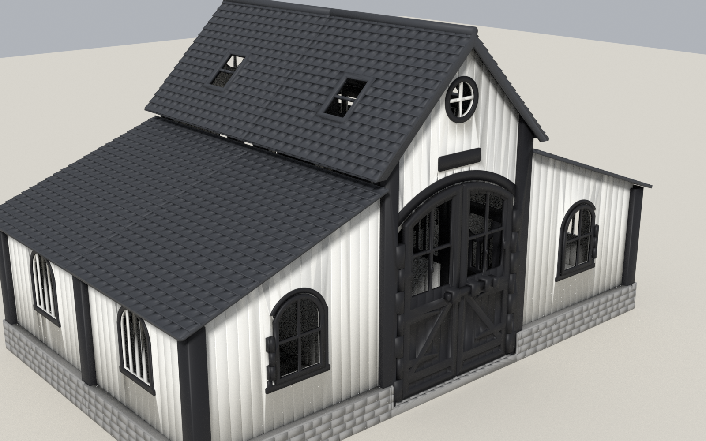
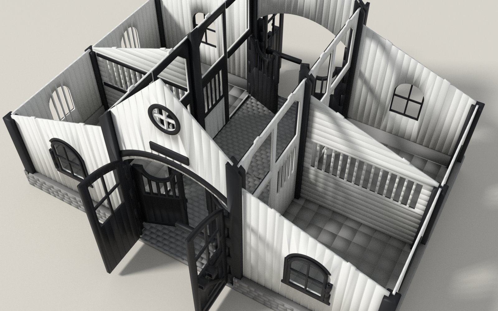

# Horse stable for Schleich-size figures (3D-printable)



A sturdy, modular toy stable with four boxes, a cobbled drive-through aisle, working doors
and windows, and a removable roof. It is designed for FDM printing on a **Bambu Lab A1**
in PLA, with **no support material** and **no glue, screws or magnets**. It is inspired by
the hand-painted Schleich stable sold by mymodelhorse.com, but it is an original design and
is not affiliated with Schleich.

| | |
|---|---|
| Footprint | 565 x 357 mm base, 577 x 363 mm with roof; about 33 cm tall |
| Stalls | 4, each 185 x 165 mm inside; sized for horses up to about 17 cm long |
| Aisle / main door | 165 mm wide aisle; arched double doors 152 mm wide, 182 mm clear at the crown |
| Moving parts | 4 main door leaves (slide bolt), 4 stall doors with click latch, 4 casement windows, 6 lift-off roof units |
| Parts | 54 printed pieces from 28 STL files; 12 hinge pins cut from 1.75 mm filament |
| Print | 31 plates, about **116 h** and **3.4 kg PLA** (PrusaSlicer estimate with A1-equivalent settings) |

| Roof off, doors open | Roof units lifted |
|---|---|
|  |  |

## Quick start

1. **Print the test coupons** `3mf/T1_test_hinges_latches.3mf` and `3mf/T2_test_fits.3mf`.
   Follow [docs/TESTING.md](docs/TESTING.md) to pick the clearances for your printer.
2. If you changed values in `cad/config.scad`, regenerate (see below).
3. **Print plates `P01`-`P31`** from `3mf/`, or the single STLs in `stl/`. Settings, colours
   and order are in [docs/PRINT_PLAN.md](docs/PRINT_PLAN.md).
4. **Assemble** with [docs/ASSEMBLY.md](docs/ASSEMBLY.md).

## Documentation

* [docs/SPEC.md](docs/SPEC.md): reference analysis, requirements, dimensions, mechanisms, CAD workflow
* [docs/PRINT_PLAN.md](docs/PRINT_PLAN.md): Bambu Studio settings, plates, time and filament per plate
* [docs/BOM.md](docs/BOM.md): parts list with quantities, pin lengths, tools
* [docs/ASSEMBLY.md](docs/ASSEMBLY.md): step by step, plus a placement map
* [docs/TESTING.md](docs/TESTING.md): how to read the test coupons
* [docs/VALIDATION.md](docs/VALIDATION.md): digital checks (generated)
* [docs/LIMITATIONS.md](docs/LIMITATIONS.md): assumptions, what is and is not verified

## Folder layout

```
cad/            OpenSCAD source (parametric)
  config.scad     ALL dimensions and tolerances
  stable.scad     main file: pick `part` (assembly or a printable part)
  instances.scad  where every part sits in the assembly, which STL it uses
  lib/            textures, hinges, latch, helpers
  parts/          floor, posts, panels, frames, doors, roof
  tests/          test coupons
stl/            printable parts (print orientation), stl/tests/ coupon plates
3mf/            ready-arranged A1 plates (one colour per plate)
tools/          build, validate, plates/slicing, report, render scripts
docs/           documentation and renders
```

## Regenerating the files

Requirements: OpenSCAD 2021.01 or newer. For validation and plates: Python 3.9+ with
`pip install trimesh manifold3d numpy scipy rtree`. Optional: PrusaSlicer (estimates) and
Blender (renders only).

```sh
python3 tools/build.py                    # all printable STLs -> stl/ (about 3 min with OpenSCAD 2021)
python3 tools/build.py --placed --swing   # + assembled poses for validation -> build/
python3 tools/validate.py                 # writes docs/VALIDATION.md
python3 tools/plates.py                   # arrange plates -> 3mf/, slice for estimates
python3 tools/report.py                   # writes docs/PRINT_PLAN.md and docs/BOM.md
python3 tools/render_export.py && tools/render_all.sh   # renders -> docs/images/
```

With OpenSCAD 2023 or newer, add `--backend manifold` to `build.py` for a large speed-up.
Interactive use: open `cad/stable.scad`, choose `part` in the Customizer, then F5 to preview
or F6 + Export STL. `part = "assembly"` shows the whole stable; `door_ang`, `show_roof` and
`explode` change the view.

### Customising
Everything is driven by `cad/config.scad`: fits (`fit_slide`, `fit_socket`, `fit_tile`,
`fit_tab`), hinge bores and pin size, `latch_engage`, wall/post/floor sizes, bay sizes (stall
and aisle size), heights and roof pitches, openings and textures. After a change, rebuild
**and re-run the validation**: it reports collisions, swing ranges and parts that no longer
fit the bed.
