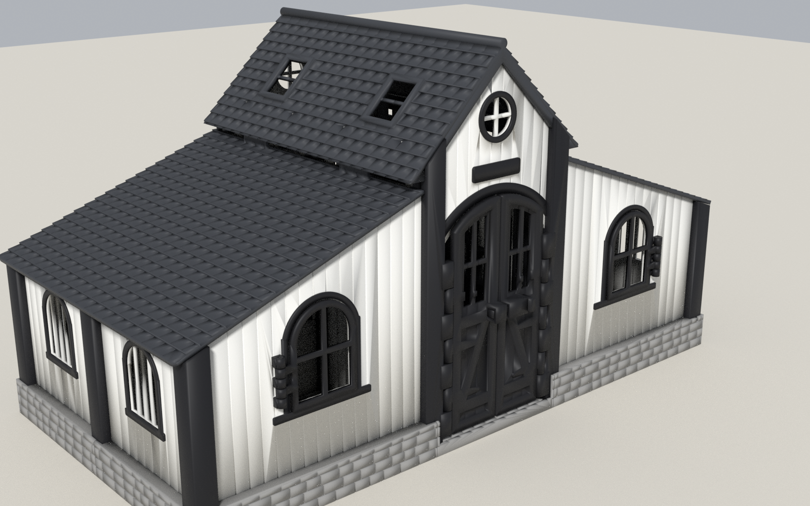
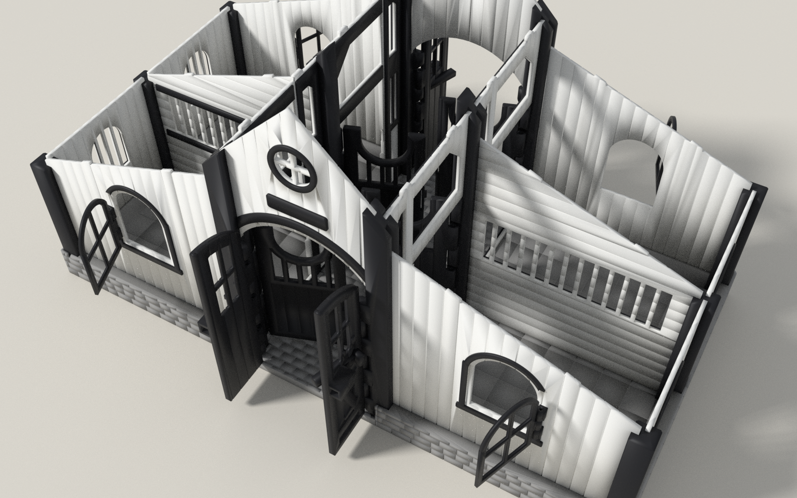
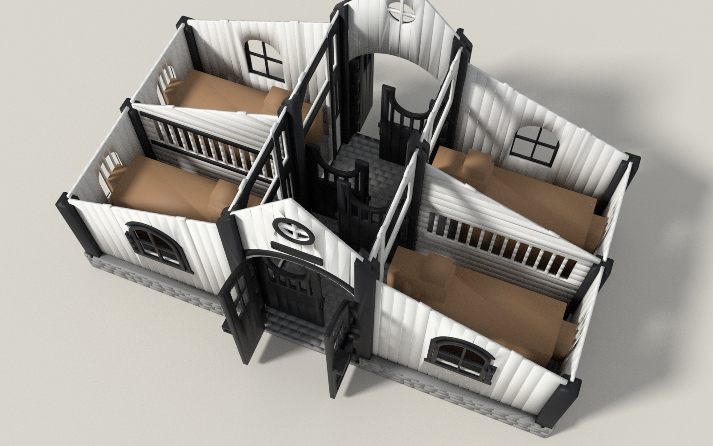

# Compact horse stable for Schleich-size figures (3D-printable)



A compact, sturdy, modular toy stable with four boxes, a cobbled drive-through aisle,
working doors and windows, and a removable roof. Its dimensions are derived from the
horse figures (see [docs/DIMENSION_PLAN.md](docs/DIMENSION_PLAN.md)): every stall fits the
largest common Schleich horse plus room for a hand, and no more.
It is designed for FDM printing on a **Bambu Lab A1** (with AMS lite for the black trims) in
PLA, with support only under the hinge knuckles of the posts, and **no glue, screws or
magnets**. It is inspired by the hand-painted Schleich stable sold by
mymodelhorse.com, but it is an original design and is not affiliated with Schleich.

| | |
|---|---|
| Size | **489 x 253 mm** base; **497 x 268 x 276 mm** overall (roof eaves and door bolts) |
| Stalls | 4, each 173 x 113 mm inside, for horses up to 170 x 53 x 120 mm (checked in the validation with a horse proxy) |
| Aisle / main door | 113 mm aisle; arched double doors 100 mm wide, 160 mm clear at the crown |
| Stall doors | 72 x 125 mm opening (62 mm passage when open) with neck yoke; latch: click latch, a drop latch (test plate T4) is proposed to replace it; left and right doors hinge at opposite ends, so all open fully in the narrow aisle |
| Moving parts | 4 main door leaves (slide bolt), 4 stall doors, 4 casement windows (hinge outside the window frame, which runs all the way round), 3 lift-off roof units (the central roof locks the side roofs) |
| Parts | 51 printed pieces from 26 STL files; 12 hinge pins cut from 1.75 mm filament |
| Print | 24 plates, about **67 h** and **2.2 kg PLA** (PrusaSlicer estimate with the same settings); every plate is a ready **Bambu Studio project** in `bambu/` |

This is the compact version (v2). The first, full-size version was 565 x 357 x 329 mm with
3.4 kg / 116 h of printing. Section 4 of the dimension plan explains where the space was
saved and why nothing was simply scaled down.

| Roof off, doors open | Design-horse proxies in the stalls |
|---|---|
|  |  |

## Quick start

1. **Print the test plates** in `bambu/TEST/` (T3a, T3b, T4; T2 if not printed yet) and follow
   [docs/TESTANLEITUNG.md](docs/TESTANLEITUNG.md) (German). T1 has been printed already.
2. Enter the confirmed fits in `cad/config.scad` and regenerate (see below). Plates that wait for
   a test (posts with hinges, gable walls, casements, stall fronts, doors) get their project
   files only then.
3. **Print the released plates** in `bambu/PRODUKTION/`: open the project in Bambu Studio, slice,
   print ([docs/BAMBU_STUDIO.md](docs/BAMBU_STUDIO.md), order and status in
   [docs/DRUCKPLAN.md](docs/DRUCKPLAN.md)).
4. **Assemble** with [docs/ASSEMBLY.md](docs/ASSEMBLY.md).

What changed in this round: [docs/AENDERUNGEN.md](docs/AENDERUNGEN.md) (German).

Viewing the assembled model: `blender/stall_kompakt.blend` (Blender 4.0 or newer) has the
exported parts in place, with open-door poses, hinge pins, horse proxies, the print plates and
10 named cameras ([views from all directions](docs/images/views/)). `docs/assembly_preview.glb`
is coloured and opens in any glTF viewer.

## Documentation

* [docs/ANALYSE.md](docs/ANALYSE.md) (Deutsch): Druckbarkeit, Überarbeitung, Scharniere, Stärken und Schwächen
* [docs/AENDERUNGEN.md](docs/AENDERUNGEN.md) (Deutsch): Änderungsliste dieser Runde
* [docs/BAMBU_STUDIO.md](docs/BAMBU_STUDIO.md) (Deutsch): die fertigen Bambu-Studio-Projekte öffnen, prüfen, drucken
* [docs/DRUCKPLAN.md](docs/DRUCKPLAN.md) (Deutsch): alle Platten mit Status, Preset, AMS-Slot, Zeit, Filament, Reihenfolge
* [docs/TESTANLEITUNG.md](docs/TESTANLEITUNG.md) (Deutsch): Teststücke T2, T3a, T3b, T4: was zusammengehört, was getestet wird, woran man ein gutes Ergebnis erkennt
* [docs/VERSCHLUSS.md](docs/VERSCHLUSS.md) (Deutsch): Klickverschluss erklärt, Vergleich, Empfehlung Fallriegel
* [docs/VERBINDUNGEN.md](docs/VERBINDUNGEN.md) (Deutsch): alle Verbindungen, rechnerisch geprüft oder durch Testdruck bestätigt
* [docs/DIMENSION_PLAN.md](docs/DIMENSION_PLAN.md): horse sizes, how each dimension follows from them, comparison with the reference and v1
* [docs/SPEC.md](docs/SPEC.md): reference analysis, requirements, dimensions, mechanisms, CAD workflow
* [docs/BOM.md](docs/BOM.md): parts list with quantities, pin lengths, tools
* [docs/ASSEMBLY.md](docs/ASSEMBLY.md): step by step, plus a placement map
* [docs/TESTING.md](docs/TESTING.md): the test coupons and how they map to `config.scad`
* [docs/VALIDATION.md](docs/VALIDATION.md): digital checks (generated)
* [docs/LIMITATIONS.md](docs/LIMITATIONS.md): assumptions, what is and is not verified

## Folder layout

```
cad/            OpenSCAD source (parametric)
  config.scad     ALL dimensions and tolerances
  stable.scad     main file: pick `part` (assembly or a printable part)
  instances.scad  where every part sits in the assembly, which STL it uses
  lib/            textures, hinges, click latch, drop latch (test), helpers
  parts/          floor, posts, panels, frames, doors, roof
  tests/          test coupons
stl/            printable parts (print orientation, current model state; parts that still wait
                for a test result are marked in docs/DRUCKPLAN.md), stl/tests/ test coupons
bambu/          Bambu Studio projects: TEST/ (print first), PRODUKTION/ (released plates)
tools/          build, validate, plates/slicing, report, render and Blender scripts
slicer/         Bambu Studio process presets (the projects carry them already)
blender/        Blender scene of the assembled stable (generated)
docs/           documentation and renders
```

## Regenerating the files

Requirements: OpenSCAD 2021.01 or newer. For validation and plates: Python 3.9+ with
`pip install trimesh manifold3d numpy scipy rtree`. Optional: PrusaSlicer (estimates) and
Blender (renders only).

```sh
python3 tools/build.py                    # all printable STLs -> stl/ (about 1 min with OpenSCAD 2021)
python3 tools/build.py --placed --swing   # + assembled poses for validation -> build/
python3 tools/validate.py                 # writes docs/VALIDATION.md (incl. horse-fit checks)
python3 tools/latch_sim.py                # drop latch test rig: kinematic check
python3 tools/plates.py                   # plates -> Bambu Studio projects in bambu/, slice checks
python3 tools/report.py                   # writes docs/DRUCKPLAN.md, docs/BOM.md, slicer presets
blender -b -P tools/render_window.py -- 150 && python3 tools/annotate_window.py   # window close-ups
blender -b -P tools/render_latch.py && python3 tools/annotate_latch.py           # latch images
python3 tools/render_export.py && tools/render_all.sh   # renders -> docs/images/
blender -b -P tools/make_blend.py                        # Blender scene -> blender/stall_kompakt.blend
blender -b blender/stall_kompakt.blend -P tools/render_views.py && python3 tools/views_sheet.py   # all view directions
blender -b -P tools/render_hinge.py && python3 tools/annotate_hinge.py   # hinge explanation -> docs/images/scharnier.png
```

With OpenSCAD 2023 or newer, add `--backend manifold` to `build.py` for a large speed-up.
Interactive use: open `cad/stable.scad`, choose `part` in the Customizer, then F5 to preview
or F6 + Export STL. `part = "assembly"` shows the whole stable; `door_ang`, `show_roof` and
`explode` change the view.

### Customising
Everything is driven by `cad/config.scad`: the design horse (`horse_l/w/h`), fits
(`fit_slide`, `fit_socket`, `fit_tile`, `fit_tab`), hinge bores (`bore_post`, `bore_free`,
`bore_win_hold`, `bore_win_free`) and pin size, `latch_engage`,
wall/post/floor sizes, bay sizes (stall depth and width, aisle), heights and roof pitches,
openings and textures. After a change, rebuild **and re-run the validation**: it reports
collisions, swing ranges, horse clearances and parts that no longer fit the bed. The plates
are re-packed automatically by `tools/plates.py`.
