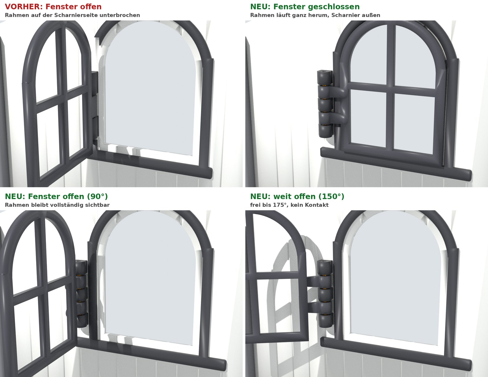
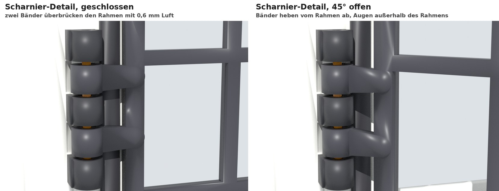
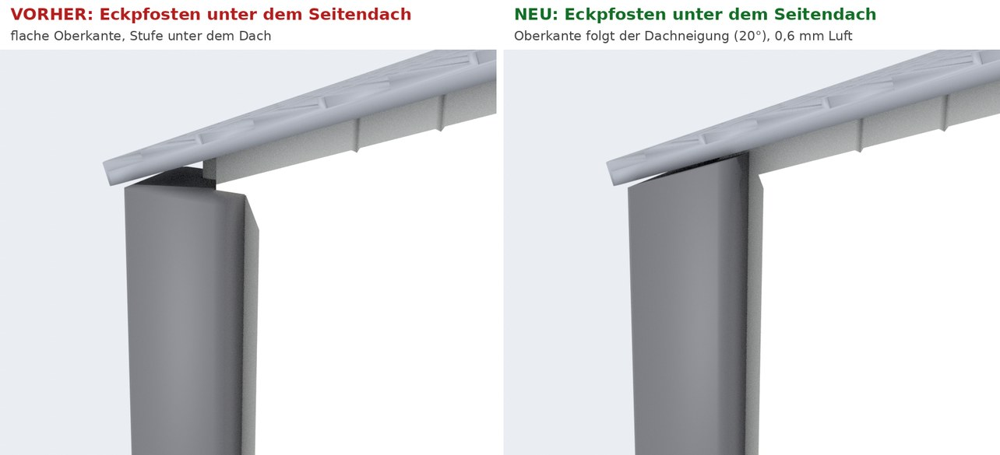

# Änderungsliste (8. und 9. November 2026)

## Kürzere Druckzeit (9. November)

Ganzer Stall: **etwa 68 statt 88 Stunden** (−24 %), 2,2 statt 2,5 kg Filament (PrusaSlicer-Schätzung
mit den gleichen Einstellungen; Bambu Studio zeigt eigene Werte). Gemessen habe ich vorher, wo die
Zeit wirklich hingeht, und nur geändert, was keine getestete Passung berührt:

| Was | Vorher | Jetzt | Wirkung |
|---|---|---|---|
| Pfosten (alle, auch Test T3a) | 0,20 mm, 4 Wände, sanfte Geschwindigkeit | **0,24 mm, 2 Wände**, normale Geschwindigkeit, nur die Beschleunigung begrenzt | hohe Pfosten 17,7 → 11,0 h, kurze 7,6 → 4,7 h |
| Boden | 0,24 mm, 3 Wände, 15 % | **0,28 mm**, 2 Wände, 10 % | 6 Platten zusammen 15,6 → 12,8 h |
| Seitenwände, Trennwände, Giebelfelder | 0,20 mm, 3 Wände | **0,24 mm**, 2 Wände | 9,9 → 8,2 h |
| Dach | 0,20 mm | **0,28 mm**, Seitendächer vollmassiv (steifer, keine langsamen Brückenlagen) | 19,5 → 14,1 h |
| Dachziegel-Fugen | durch die ganze Ziegelreihe geschnitten | nur 0,4 mm tief, sieht gleich aus, viel weniger Einzelinseln beim Druck | in der Dachzeit enthalten |
| Bretterfugen auf der Innenseite der Wände (Druckbett-Seite) | 0,4 mm tief | **weggelassen**: Sie erzwangen langsame Brückenlagen. Außen bleiben die Fugen | etwa −13 % je Wandplatte |

**Unverändert bei 0,20 mm** bleiben Türen, Fensterflügel, Giebelwände und Boxenfronten. Ihre
Passungen (Türscharnier 2,15, Fensterstift, Verschluss) sind bei 0,20 mm getestet bzw. werden es in
T3b und T4. Nach deinen Tests kann ich auch diese Platten beschleunigen.

Die Pfosten-Testplatte T3a und der Boden-Test T2 sind mit den neuen Einstellungen erzeugt, damit sie
genau so gedruckt werden wie die Pfosten und Bodenplatten später. Der Filamentwechsel der Wände liegt
bei 0,24-mm-Schichten bei 3,08 mm (erste Schicht über der Wandfläche), auch das ist gespeichert.

Wer noch schneller will: Am A1 kann man während des Drucks auf „Sport“ stellen. Für Boden und Dach
geht das meist gut; für die Pfosten nicht, die kippeln sonst.

## Fenster

* Der schwarze Fensterrahmen läuft jetzt **ganz herum**, bei geschlossenem und bei offenem Fenster.
  Die Aussparung auf der Scharnierseite ist weg. Ich habe sie nicht einfach gefüllt: Das Scharnier
  sitzt jetzt **außerhalb des Rahmens**.
* Der Fensterflügel greift mit **zwei Bändern über den Rahmen**, mit 0,6 mm Luft. Das Scharnier hat
  jetzt 5 Augen statt 3: 3 an der Wand, 2 am Flügel.
* Der ganze Schwenkweg ist in 5-Grad-Schritten geprüft: frei von 0 bis 175 Grad, erst bei 180 Grad
  berührt der Flügel den Eckpfosten. Kleinster Abstand unterwegs 0,5 mm, zum schwarzen Rahmen
  mindestens 0,6 mm. Unter den drehenden Augen ist die Wand 0,4 mm vertieft (verdeckt).
* Die Fensterbank reicht unter das Scharnier.
* Der Stift wird weiter von oben eingesteckt. Das oberste Wandauge ist etwas enger (1,95 mm,
  vorläufig) und hält den Stift fest. Die übrigen Augen sind frei.
* Der Fensterflügel bekommt beim Druck einen kleinen 3-mm-Brim (in der Projektdatei gespeichert).

## Eck- und Seitenpfosten (dein Wunsch vom 8. November)

* Die Oberkante der 4 Eckpfosten und der 2 Seitenpfosten folgt jetzt der Neigung des Seitendachs
  (20 Grad), 0,6 mm darunter. Es gibt keine Stufe mehr unter dem Dach. Das Dach liegt weiterhin
  nicht auf den Pfosten, sondern auf den Wänden; nachgeprüft: überall 0,56 mm Luft, Dach hebt sich
  ab und bleibt verriegelt wie vorher.
* Die Pfosten werden dadurch 124 statt 118 mm hoch. Die Schräge ist beim stehenden Druck die
  Oberseite, braucht also keine Stützen. Die Gang-Pfosten folgen schon dem Mitteldach.
* Betrifft die freigegebene Platte P07; sie ist neu erzeugt und probegesliced.

## Scharnier-Passungen

* Drei getrennte Lochgrößen statt zwei, je nach Druckrichtung:
  * **Pfosten** (stehend gedruckt): `bore_post`, noch offen. Laut T1 sind 1,75 bis 1,95 mm zu eng,
    T3a testet 2,05 bis 2,45 mm.
  * **Türen und Fensterflügel** (flach gedruckt): `bore_free` = **2,15 mm**, durch deinen T1-Test
    bestätigt und übernommen. Betrifft Tore, Boxentüren und Fensterflügel.
  * **Fensterrahmen an der Wand** (flach gedruckt): unten 2,15 mm, oben 1,95 mm (klemmt). Der
    Klemmwert ist vorläufig, T3b prüft ihn.
* Neu: eine kleine 45-Grad-Einführschräge unten an jedem Pfostenauge, damit der Stift das nächste
  Auge leichter findet.

## Verschluss der Boxentüren

* Den Klickverschluss habe ich geprüft und mit Alternativen verglichen ([VERSCHLUSS.md](VERSCHLUSS.md)).
  Empfehlung: **Fallriegel**. Er fällt beim Schließen von selbst ein, sperrt formschlüssig und ist
  unempfindlich gegen Toleranzen.
* Der Fallriegel steckt bisher nur im **Teststück T4**. Die Produktionsteile behalten den alten
  Klickverschluss, bis dein Test gut ausfällt.

## Neue Teststücke

* **T3a:** 5 Pfosten-Scharnierstücke (2,05 bis 2,45) und der Nutenpfosten. Gleiche Druckrichtung und
  Einstellungen wie die echten Pfosten.
* **T3b:** Türflügel-Teststücke 2,15 (für den zusammengebauten Scharniertest), ein Stück Giebelwand
  mit dem neuen Fenster, der echte Fensterflügel, ein Fuß, Fensterstift-Klemmstücke 1,85 / 1,95 /
  2,05, Wandstreifen, Dachzapfen.
* **T4:** Fallriegel-Prüfstand (Rahmen, Tür, Hebel, Fuß) und der Tor-Riegel mit seinen Schlaufen.
* **T2** liegt als Projektdatei bei, falls noch nicht gedruckt.

## Bambu-Studio-Projekte

* Jede Platte ist ein fertiges Projekt mit Drucker, Filamenten, Prozess, Ausrichtung, Brim, Stützen
  und Filamentwechsel ([BAMBU_STUDIO.md](BAMBU_STUDIO.md)). Die alten Nur-Geometrie-Dateien sind weg.
* Neues Pfosten-Preset **v2** mit sanfteren Geschwindigkeiten und Beschleunigungen. Am Drucker
  musst du nicht mehr auf „Leise“ stellen.
* Getrennte Ordner: **1_TEST** und **2_PRODUKTION**. In 2_PRODUKTION liegen nur die Platten, die nicht
  von den neuen Scharnier- und Verschlusstests abhängen: Boden, Eck- und Seitenpfosten, Wände, Dach.
  Ihre Passungen (Sockel, Verzahnung, Nuten, Zapfen) sind unverändert und nur berechnet. T2, T3a und
  T3b prüfen sie mit, deshalb diese Platten nach den Tests drucken.
* **Gesperrt bis zum Test:** Pfosten mit Scharnieraugen, Giebelwände, Fensterflügel (T3);
  Boxenfronten, Boxentüren, Tore mit Riegeln (T4).

## Prüfung

* Alle 51 Bauteile neu exportiert und geprüft: keine Überschneidung, alles beweglich, alle Stifte
  frei, Pferde passen, Dach verriegelt ([VERBINDUNGEN.md](VERBINDUNGEN.md), [VALIDATION.md](VALIDATION.md)).
* Jede Platte wurde probegesliced: Alles liegt einschließlich Brim und Stützen auf dem Bett, und
  keine Stütze sitzt in einem Scharnierloch.
