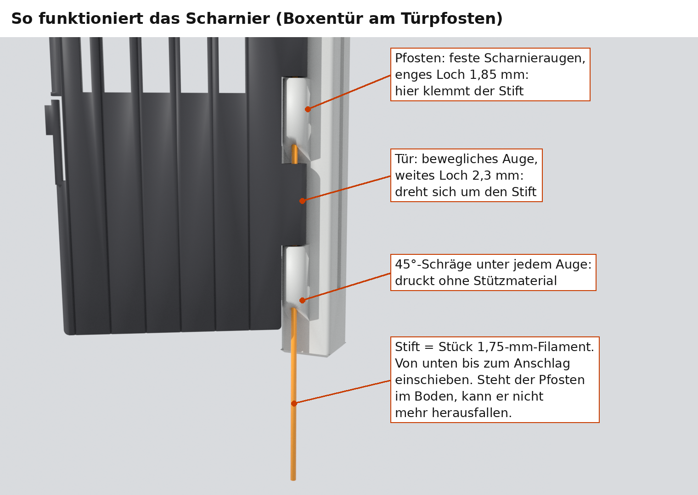
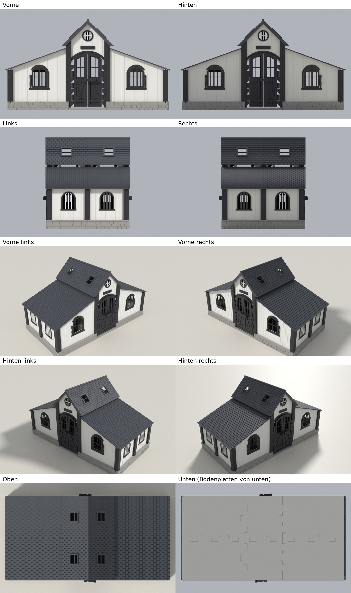

# Analyse: Druckbarkeit, Mängel, Stärken und Schwächen

Stand 7. November 2026, ergänzt am 8. November 2026 (Fenster, Scharnier-Passungen, Verschluss,
Bambu-Studio-Projekte: siehe [AENDERUNGEN.md](AENDERUNGEN.md)). Geprüft wurde die exportierte
Geometrie, also genau die Teile, die gedruckt werden: mit `tools/validate.py`, zusätzlichen
Prüfungen und dem Stabilitätscheck von PrusaSlicer. **Gedruckt ist bisher nur die Testplatte T1.**
Daraus ist das Türloch 2,15 mm bestätigt; die Pfostenlöcher 1,75 bis 1,95 mm waren zu eng. Alle
anderen Passungen und Kräfte sind berechnet, nicht gemessen. Welche Verbindung wie geprüft ist:
[VERBINDUNGEN.md](VERBINDUNGEN.md). Als Nächstes: die Testplatten T3a, T3b, T4
([TESTANLEITUNG.md](TESTANLEITUNG.md)).

Für ein Kind von 9 Jahren gebaut: zerlegbar, ohne Kleber, robust für viel Spiel.

## Kurzfazit

* **Gut druckbar auf dem Bambu Lab A1:** 24 Druckplatten, alle Teile passen aufs Bett, auch mit
  Brim und Stützen. Stützen nur unter den Scharnieraugen der hohen Pfosten. Jede Platte ist ein
  fertiges Bambu-Studio-Projekt mit allen Einstellungen ([BAMBU_STUDIO.md](BAMBU_STUDIO.md)).
* **Die Schwachstellen sind überarbeitet:** Das Dach besteht jetzt aus 3 Teilen und ist
  verriegelt. Fenster, Gitterstäbe und Bodenverbindung sind kräftiger.
* **Heikelster Druck bleibt die Platte mit den sechs 216 mm hohen Pfosten**, weil das
  Druckbett des A1 sich unter ihnen bewegt.

## 1. Was überarbeitet wurde

| Schwachstelle | Vorher | Jetzt |
|---|---|---|
| Dach | 6 Teile, nur aufgelegt; fiel beim Kippen leicht ab | **3 Teile** (Mitteldach, zwei Seitendächer). Das Mitteldach **verriegelt** die Seitendächer: Zwei kurze Sperrrippen stehen 1 mm unter dem Mitteldach. Solange es drauf ist, kommt ein Seitendach nach 1,25 mm Anheben nicht weiter, also nicht aus seinen 1,6 mm hohen Zapfen heraus (geprüft). Jedes Dachteil ist 242,8 mm lang und passt aufs 256-mm-Bett; dafür ist der Dachüberstand an den Giebeln von 10 auf 4 mm geschrumpft |
| Scharnieraugen an den Pfosten | 45-Grad-Schräge unten (ohne Stützen druckbar) | **volle Augen**, gedruckt mit kleinen Baumstützen (dein Wunsch). Jede Stütze steht auf dem Auge darunter, also kurz und leicht zu entfernen. 0,8 statt 0,5 mm Spiel zwischen den Augen, damit Stützreste die Tür nicht bremsen. Die Schräge bleibt als Option (`knuckle_chamfer` in `cad/config.scad`) |
| Fensterflügel | Scharnierwand 1,45 mm, Rahmen 2,4 mm | Scharnieraugen 6,4 statt 5,2 mm (Wand 2,05 mm), Rahmen 3,0 mm, Sprossen 3,0 mm |
| Gitterstäbe | 3 mm breit, an der Trennwand nur 2,8 mm dick | Trennwand: 4 mm breit und erhaben, 4,2 mm dick (schwarz); Boxentür: 3,5 mm; Sprossen der Tore: 3,0 mm |
| Bodenplatten-Verbindung | 20 mm breite Zungen, 20,5 mm Brücke, 0,25 mm Luft | 14 mm breite Zungen, mehr pro Fuge, 14,5 mm Brücke und 0,4 mm Luft nach oben. Hängt die Brücke etwas durch, klemmt nichts. PrusaSlicer meldet keine langen Brücken mehr |
| Druck der hohen Pfosten | 26 mm Abstand | 60 mm Abstand (ein umfallender Pfosten reißt die anderen nicht mit), 8 mm Brim, begrenzte Beschleunigung im Preset „Pfosten v3“ (am Drucker nichts umstellen) |
| Riegel | 2 Stück, lose | dazu 2 Ersatzriegel auf der Türplatte |
| Slicer | nur Hinweise | 4 Bambu-Studio-Presets, Druckplatten-Tabelle mit Preset, AMS-Slot und Farbwechsel |

Unverändert und geprüft: Alle Pferde passen (Designpferd 170 x 53 x 120 mm in jeder Box, durch
Boxentür und Tor). Keine Teile überschneiden sich. Alle Türen und Fenster schwenken frei, auch
alle gleichzeitig. Alle 12 Stifte laufen frei. Der Klick-Verschluss rastet im Nennmaß; er ist
aber empfindlich gegen Toleranzen und soll durch einen Fallriegel ersetzt werden ([VERSCHLUSS.md](VERSCHLUSS.md)).

## 2. Druckbarkeit auf dem A1

| Teile | Druckrichtung | Bewertung | Was zu beachten ist |
|---|---|---|---|
| Bodenplatten (6) | flach, 0,24 mm Schichten | sehr gut | große Auflagefläche; unten 14,5-mm-Brücken über den Zungen-Aussparungen |
| Wände, Trennwände, Boxenfronten, Giebel (16) | flach, Schauseite oben | sehr gut | Filamentwechsel knapp über der Wandfläche für schwarze Zierleisten (macht das AMS lite, im Projekt gespeichert) |
| Türen, Fensterflügel, Riegel (14 + 2 Ersatz) | flach | gut | Scharnierbohrungen tropfenförmig, keine Stützen; Fensterflügel mit 3-mm-Brim |
| Kurze Pfosten (6, 124 mm) | stehend | gut | 8 mm Brim; Oberkante schräg wie das Seitendach |
| Hohe Pfosten (6, 216 mm) | stehend | **anspruchsvoll** | stehen auf nur 14 x 14 mm; Baumstützen unter 28 Scharnieraugen; 8 mm Brim, sanfte Beschleunigung (im Projekt gespeichert), Platte mit Spülmittel waschen, die erste Stunde zuschauen |
| Mitteldach (1) | stehend wie eingebaut, 45 Grad | gut | steht auf zwei 5 mm breiten, 243 mm langen Streifen; 5 mm Brim |
| Seitendächer (2) | flach, Schindeln oben | sehr gut | 243 x 193 mm; Sperrrippen zeigen nach oben |

Die Pfosten stehend zu drucken ist richtig: Nur so werden Nuten und Scharnierbohrungen rund und
fest, und die Ringe der Scharnieraugen liegen in der Schicht (stärkste Richtung).

## 3. So funktionieren die Scharniere

Der Scharnierstift ist **ein Stück ganz normales 1,75-mm-Filament.**

* Am Pfosten sitzen feste **Scharnieraugen**. Ihr Loch wird gerade mit T3a bestimmt; in T1
  waren 1,75 bis 1,95 mm zu eng. Die Tür hat ihre Augen in den Lücken dazwischen, mit weitem Loch
  (**2,15 mm, durch deinen Test bestätigt**): Sie dreht sich frei um den Stift. Den Stift hält
  unten der Boden und oben das geschlossene Ende des obersten Auges.
* **Nach dem Druck:** die kleinen Baumstützen unter den Augen mit einer Spitzzange herausdrehen,
  Reste mit dem Cutter glätten. Ein Türauge muss ohne Kraft in die Lücke gleiten.
* **Zuschneiden:** 4 x 126 mm (Tore), 4 x 122 mm (Boxentüren), 4 x 30 mm (Fenster). Filament gerade
  ziehen, Enden sauber abknipsen und leicht entgraten. Frisches, trockenes Filament nehmen;
  PETG-Filament ist zäher.
* **Einbau Türen:** Tür an den Pfosten halten, Stift **von unten** bis zum Anschlag durchschieben,
  dann den Pfosten in den Boden stecken. Der Boden hält den Stift von unten.
* **Einbau Fenster:** Stift **von oben** einstecken; er steht unten auf einem geschlossenen Loch,
  das oberste Wandauge klemmt ihn. Das Scharnier sitzt außerhalb des schwarzen Fensterrahmens.
* **Testen:** T3a (Pfostenloch, zusammengebautes Scharnier) und T3b (Fenster); die Lochgrößen
  heißen in `cad/config.scad` `bore_post`, `bore_free`, `bore_win_hold`, `bore_win_free`.

## 4. Stärken

* **Passt zu echten Schleich-Pferden,** auch zum größten gängigen (Shire, 17 cm).
* **Kompakt:** 49 x 25 cm Grundfläche, 27,6 cm hoch.
* **Viel Spielwert:** 4 Boxentüren mit Verschluss und Halsausschnitt, zwei Doppeltore
  mit Riegel, 4 Fenster zum Öffnen, das Dach mit zwei Griffen ab (Mitteldach, dann Seitendach).
* **Kräftig:** 16-mm-Pfosten, Wände in Nuten, verzahnter 8-mm-Boden, kräftigere Fenster und
  Gitter, verriegeltes Dach.
* **Echte Stift-Scharniere;** jedes Teil einzeln ersetzbar, nichts geklebt.
* **Fertig für Bambu Studio:** Presets, Plattenliste, AMS-Belegung.

## 5. Schwächen, die bleiben

* **Noch nicht alles getestet:** T1 ist gedruckt. T3a, T3b und T4 (und T2) klären die übrigen
  Passungen und den neuen Verschluss. Bis dahin sind Pfosten mit Scharnieren, Giebelwände,
  Fensterflügel, Boxenfronten und Türen gesperrt.
* **Klick-Verschluss** der Boxentüren: empfindlich gegen Toleranzen. Ersatz durch einen Fallriegel
  ist vorbereitet (Test T4, [VERSCHLUSS.md](VERSCHLUSS.md)).
* **Hohe Pfosten** bleiben der anspruchsvollste Druck (Abschnitt 2).
* **Stützen entfernen:** 28 kleine Bäume an den Pfosten, etwa 15 Minuten Arbeit.
* **Wände sind gesteckt** (zerlegbar, wie gewünscht). Mit Dach sind sie gehalten; ohne Dach kann
  man sie herausziehen. Den Stall immer am Boden tragen.
* **Das Mitteldach liegt auf.** Es hält beim normalen Tragen; auf den Kopf gestellt fällt es ab.
* **Türen nicht mit Gewalt über den Anschlag drücken** (Tore 105 Grad, Boxentüren 90 bis
  105 Grad); das belastet die Scharnieraugen.
* **PLA** wird bei etwa 55 °C weich (Auto im Sommer, sonnige Fensterbank).
* **Aufwand:** 24 Platten, rund 67½ h und 2,25 kg Filament (PrusaSlicer-Schätzung; Bambu Studio
  zeigt eigene Werte), dazu 1 bis 2 Stunden Zusammenbau.

## 6. Drucken

Siehe [BAMBU_STUDIO.md](BAMBU_STUDIO.md) und [DRUCKPLAN.md](DRUCKPLAN.md): Projektdatei öffnen,
slicen, drucken. AMS lite: 1 Weiß, 2 Schwarz, 3 Hellgrau, 4 Dunkelgrau. Alles andere, auch der
Filamentwechsel für die schwarzen Leisten, steht in den Dateien. Reihenfolge: Tests T3a, T3b, T4 (T2), dann die
freigegebenen Platten (Boden, Eck- und Seitenpfosten, Wände, Dach), nach den Tests der Rest.

## 7. Die Blender-Datei

`blender/stall_kompakt.blend` (ab Blender 4.0) enthält die exportierten Druckteile in Einbaulage,
keine nachgebaute Geometrie. Erzeugt wird sie mit `tools/make_blend.py`.

* **Sammlungen** (Outliner, Augen-Symbol): „Stall (zusammengebaut)“ mit Boden, Pfosten, Wänden,
  Türen und Dach. Ausgeblendet: „Tueren offen (90 Grad)“, „Scharnierstifte“ (orange),
  „Pferd-Platzhalter“ und „Druckplatten“ (alle Platten auf 256-mm-Betten, rechts neben dem Stall).
* **Ansichten:** 10 Kameras. Kamera im Outliner anklicken, dann Strg+Ziffernblock 0. Frei drehen:
  mittlere Maustaste; Pos1 zeigt alles. Maße in Millimetern, F12 rendert.
* Ohne Blender: `docs/assembly_preview.glb` in einem beliebigen glTF-Viewer.
