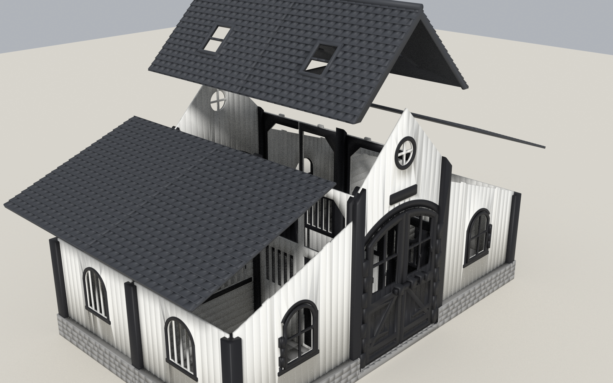
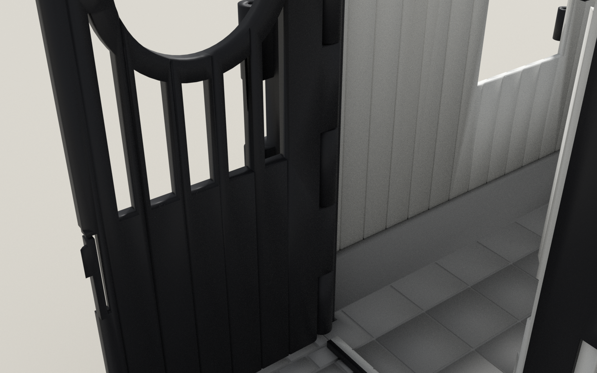
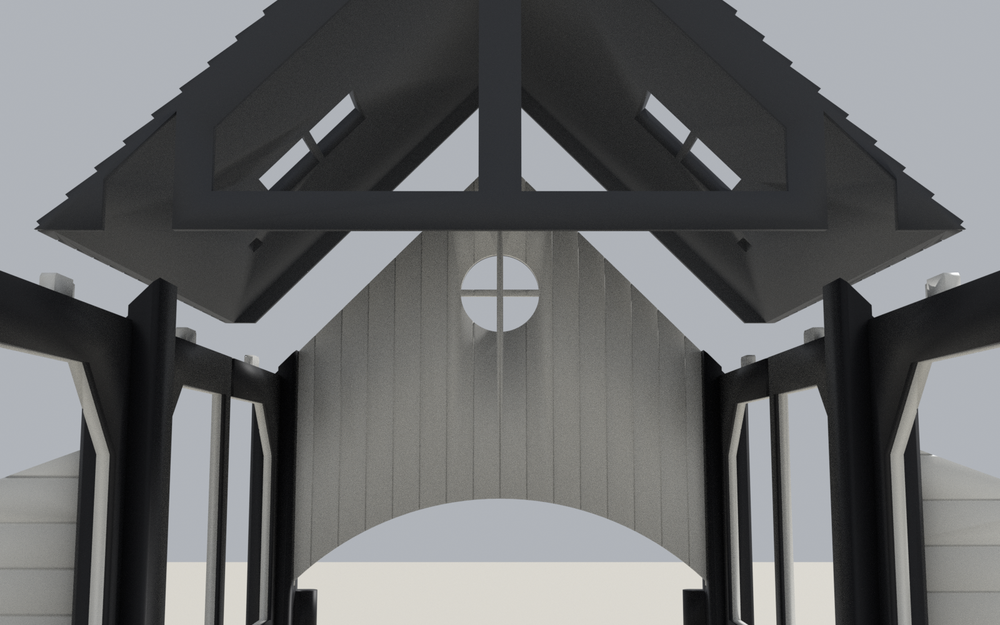

# Assembly guide

No glue, no screws. Every part can be taken out again later.
You need: the printed parts, about 1.25 m of 1.75 mm filament for the hinge pins
(cut: 4 x 146 mm, 4 x 122 mm, 4 x 33 mm), flush cutters.



## Where everything goes (plan view, front at the bottom)

```
                                   BACK (second gable, same as the front)
 corner ── gable_wing_B ── jamb_R ══ main_leaf_B | main_leaf_A ══ jamb_L ── gable_wing_A ── corner
   │       (casement_B)      │        pediment    bolt bar        │       (casement_A)        │
 side_wall   STALL BL   stall_front_B          AISLE          stall_front_A   STALL BR   side_wall
   │                    + stall_door_B                        + stall_door_A               │
 sidemid ──── partition ──── mid ───────────────────────────────── mid ──── partition ──── sidemid
   │                    + stall_door_A                        + stall_door_B               │
 side_wall   STALL FL   stall_front_A          AISLE          stall_front_B   STALL FR   side_wall
   │       (casement_A)      │        pediment    bolt bar        │       (casement_B)        │
 corner ── gable_wing_A ── jamb_L ══ main_leaf_A | main_leaf_B ══ jamb_R ── gable_wing_B ── corner
                                   FRONT
 floor tiles:  floor_LF  floor_AF  floor_RF   (front row)
               floor_LB  floor_AB  floor_RB   (back row)
```

Parts marked `_A`/`_L` and `_B`/`_R` are mirror images. The back half of the stable is the
front half rotated by 180 deg. That is why `stall_front_A` appears at front-left and back-right.

## Before you start

1. Print and check the test coupons (`TESTING.md`). Copy any changed values into `cad/config.scad`.
2. Remove brims. Make sure the **post grooves** are clean: a 2.8 mm panel strip should slide in
   by hand.
3. Test each hinge pin: it should be snug in the post knuckles and turn freely in the door
   knuckles. Straighten the filament for the pins by pulling it gently. Cut the ends square.

## 1. Floor (6 tiles)

The tiles lock together with **fingers under their edges**. You slide them together
horizontally on a flat table. Do not press them down from above.

1. Place `floor_LF` and `floor_AF` about 15 mm apart along X. Slide `AF` toward `LF` until
   the edges meet.
2. Do the same with `floor_LB` + `floor_AB`.
3. Slide the front pair and the back pair together along Y.
4. Slide `floor_RF` and `floor_RB` together along Y, then slide that pair onto the centre
   along X.
5. The base now holds together vertically. Once the posts are in, it can be lifted by its
   edges.

## 2. Hang the doors on the jamb posts

Each door post (`post_jamb_L` x2, `post_jamb_R` x2) carries a main door leaf and a stall door.

1. **Stall door:** hold the door so its two knuckles sit in the gaps between the post's
   knuckles on the stall-front side. Push a **122 mm** pin up from below through all
   knuckles until it stops. Pairs: `stall_door_A` on `post_jamb_L`, `stall_door_B` on
   `post_jamb_R`.
2. **Main door leaf:** the same on the other face with a **146 mm** pin. Pairs:
   `main_leaf_A` on `post_jamb_L`, `main_leaf_B` on `post_jamb_R`.
3. The pin ends now hang out at the bottom. They will rest on the floor, which keeps them in.



## 3. Posts

Push all 12 posts into their sockets: 4 corners, 2 side-mid, 2 mid-aisle, and 4 jamb posts
with their doors. The four corner posts are identical, as are the two side-mid posts.
Rotate each one so its grooves line up with the plinth grooves of the walls that meet it.
For the jamb posts, the main door must face outward and the stall door toward the stall front.

## 4. Walls

All panels slide **straight down** into the post grooves, and into the plinth or floor groove
below.

1. `side_wall` (x4), between the corner and side-mid posts. The window trim faces outward.
2. `gable_wing_A` at front-left and back-right, `gable_wing_B` at front-right and back-left.
   Hang each casement by dropping a **33 mm** pin into the hinge from the top. The casement
   can also be fitted later.
3. `partition` (x2), between a side-mid post and a mid post.

## 5. Stall fronts

1. Swing the stall door open into the aisle.
2. Slide the stall front down between the jamb post (upper groove) and the mid post:
   `stall_front_A` at front-left and back-right, `stall_front_B` at front-right and back-left.
   The raised frame and bars face the aisle.
3. Close the stall door. It should **click** into the latch with a light push, and open with
   a light pull.

## 6. Pediments

Close the main doors. Slide each `pediment` down between the two jamb posts above the door
opening. The arch band and name plate face outward. The door leaves now close against the
back of the pediment.

## 7. Roof

The roof is six loose units that sit by gravity. Nothing snaps.

1. **Side roofs first:** `roof_side_A` at front-left and back-right, `roof_side_B` at
   front-right and back-left. Each rests on the side wall, the gable wing and the partition.
   Lower it so the small tabs on the gable wing and partition drop into the pockets
   underneath.
2. **Central roof** (`roof_central` x2): lower each unit straight down. The notches in the
   rear truss straddle the two mid posts, and the tabs on the stall-front beams find the
   pockets.

**To open:** lift a central unit straight up. With the central unit off, the side units lift
straight up. With it on, lift a side unit about 5 mm and pull it outward.



## 8. Bolt bar

Slide the bar through the two loops of the right-hand leaf (seen from outside), knob on the
right. To lock, push it left into the loop of the left leaf. To unlock, slide it right.

## Replacing a part

* Doors: take off the pediment (main doors) or the stall front (stall doors), lift the post
  out, and push the pin out from below.
* Panels: lift the roof unit above, then pull the panel straight up.
* Floor tiles: remove the posts on that joint, then slide the tile out the way it went in.

## Care

PLA softens at about 55 C. Keep the stable out of hot cars and direct sun behind glass.
Hinge pins are long, thin, small parts. Check them now and then, and keep them away from
children under 3.
