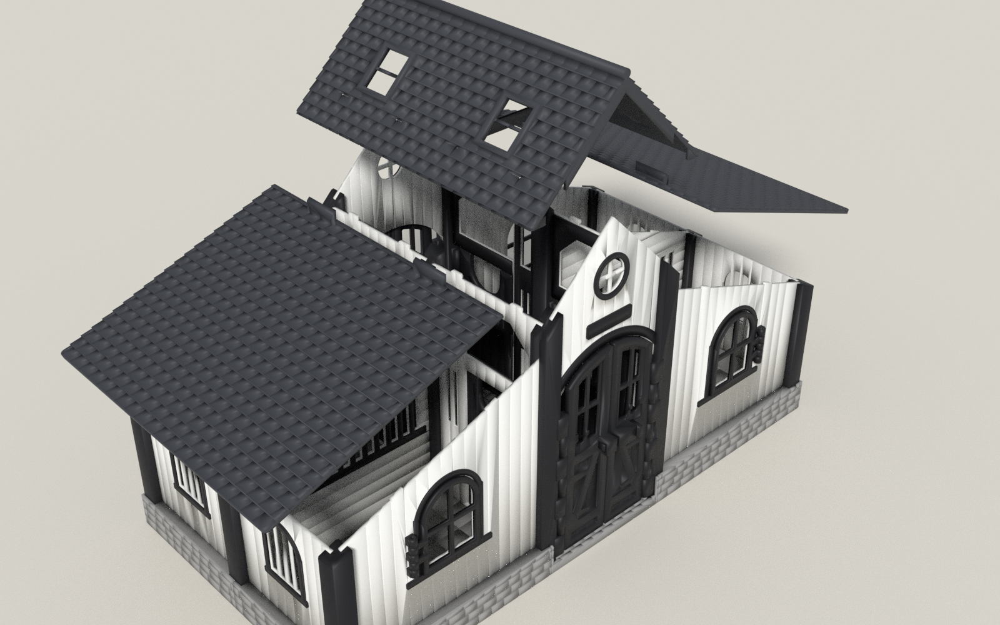
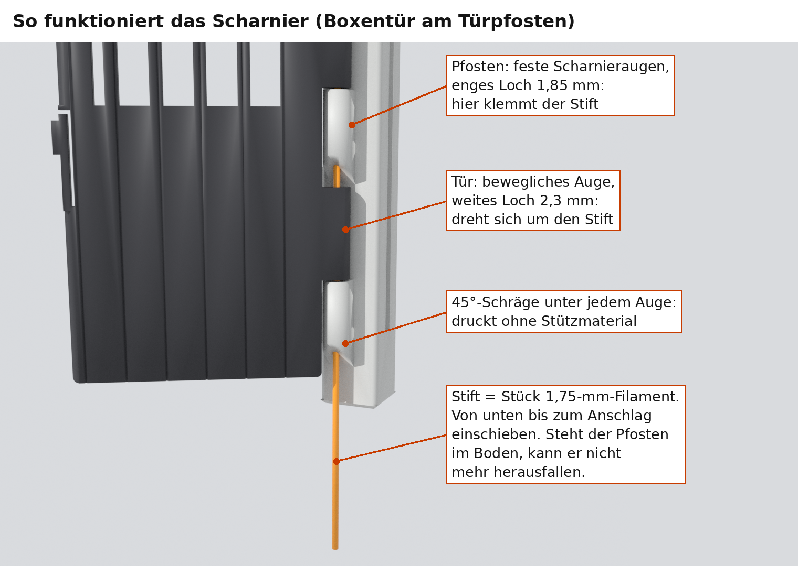
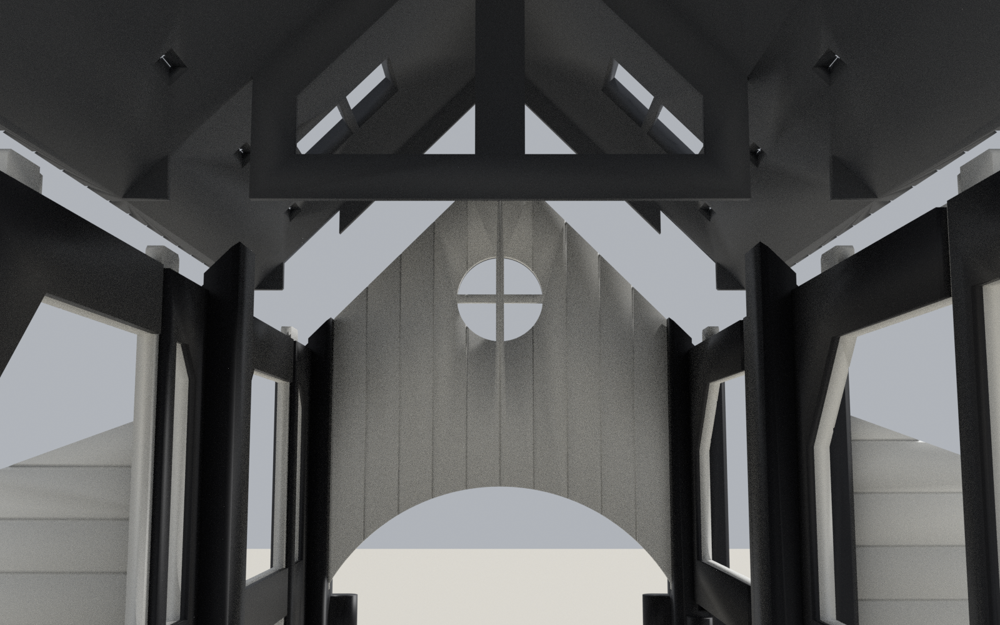
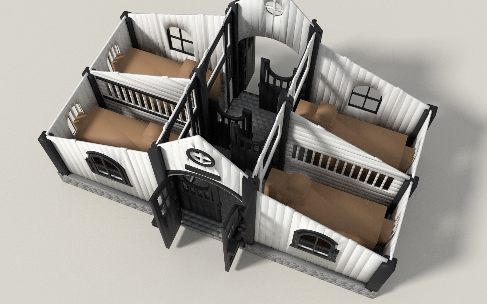

# Assembly guide

No glue, no screws. Every part can be taken out again later.
You need: the printed parts, about 1.2 m of 1.75 mm filament for the hinge pins
(cut: 4 x 126 mm, 4 x 122 mm, 4 x 30 mm), flush cutters.



## Where everything goes (plan view, front at the bottom)

```
                                   BACK (the front, rotated 180 deg)
 corner ── gable_wing_B ── jamb_R ══ main_leaf_B | main_leaf_A ══ jamb_L ── gable_wing_A ── corner
   │       (casement_B)      │         pediment     bolt bar        │ door BR (casement_A)      │
 side_wall    STALL BL     bars                                     │          STALL BR    side_wall
   │                         │ door BL          AISLE             bars                        │
 sidemid ──── partition ──── mid ────────────────────────────────── mid ──── partition ──── sidemid
   │                       bars                           door FR │                           │
 side_wall    STALL FL       │                  AISLE             bars         STALL FR    side_wall
   │       (casement_A)      │ door FL                              │       (casement_B)        │
 corner ── gable_wing_A ── jamb_L ══ main_leaf_A | main_leaf_B ══ jamb_R ── gable_wing_B ── corner
                                   FRONT
 floor tiles:  floor_LF  floor_AF  floor_RF   (front row)
               floor_LB  floor_AB  floor_RB   (back row)
```

All four stall fronts are the same part (`stall_front`), and so are all four stall doors
(`stall_door`). Seen from the aisle, every stall door is on the left of its stall front.
So the left doors sit at the gables and the right doors at the middle. Facing doors never
meet, and all of them open fully in the narrow aisle.

Parts marked `_A`/`_L` and `_B`/`_R` are mirror images. The back half of the stable is the
front half rotated by 180 deg.

## Before you start

1. Print and check the test coupons (`TESTING.md`). Copy any changed values into `cad/config.scad`.
2. Snip the small tree supports off the hinge knuckles of the tall posts (pliers). The gaps
   between the knuckles must be clean: a door knuckle has to slide in without force.
3. Remove brims. Make sure the **post grooves** are clean: a 2.8 mm panel strip should slide in
   by hand.
4. Test each hinge pin: it should go through the post knuckles by hand (the bore size comes
   from test T3a) and turn freely in the door knuckles. Each post knuckle has a small lead-in
   chamfer underneath that guides the pin. Straighten the filament for the pins by pulling it
   gently. Cut the ends square.

## 1. Floor (6 tiles)

The tiles lock together with **fingers under their edges**. You slide them together
horizontally on a flat table. Do not press them down from above.

1. Place `floor_LF` and `floor_AF` about 15 mm apart along X. Slide `AF` toward `LF` until
   the edges meet.
2. Do the same with `floor_LB` + `floor_AB`.
3. Slide the front pair and the back pair together along Y.
4. Slide `floor_RF` and `floor_RB` together along Y, then slide that pair onto the centre
   along X.
5. The base now holds together vertically. Once the posts are in, it can be lifted by its
   edges.

## 2. Hang the doors on their posts

Hold each door so its knuckles sit in the gaps between the post's knuckles, then push the pin
up from below through all knuckles until it stops. The pin ends hang out at the bottom; they
will rest on the floor, which keeps them in.

| Post (qty) | Main door leaf, **126 mm** pin | Stall door, **122 mm** pin |
|---|---|---|
| `post_jamb_L` (2) | `main_leaf_A` | `stall_door` |
| `post_jamb_R` (2) | `main_leaf_B` | none |
| `post_mid` (2) | none | `stall_door` |



## 3. Posts

Push all 12 posts into their sockets: 4 corners, 2 side-mid, 4 gable-door posts and 2 mid
posts, each with its doors. The four corner posts are identical, as are the two side-mid
posts. Rotate each one so its grooves line up with the plinth or floor grooves of the walls
that meet it. The sloped top of the corner and side-mid posts then rises toward the
inside of the stable, parallel to the side roof.

* `post_jamb_L` goes at **front-left** and **back-right**. `post_jamb_R` goes at front-right
  and back-left. The main door faces outward. On the jamb_L posts the stall door faces along
  the stall front.
* Each mid post stands with its stall door toward the **back** on the left side (stall BL) and
  toward the **front** on the right side (stall FR). The two mid posts are the same part,
  rotated 180 deg.

## 4. Walls

All panels slide **straight down** into the post grooves, and into the plinth or floor groove
below.

1. `side_wall` (x4), between the corner and side-mid posts. The window trim faces outward.
2. `gable_wing_A` at front-left and back-right, `gable_wing_B` at front-right and back-left.
   Hang each casement: hold it closed in front of the window so its two hinge straps lie over
   the black frame and its two knuckles sit in the gaps of the three wall knuckles (outside the
   frame), then drop a **30 mm** pin into the hinge from the top. The top wall knuckle is a
   little tighter and holds the pin; push it down the last few millimetres. The casement can
   also be fitted later.
3. `partition` (x2), between a side-mid post and a mid post.

## 5. Stall fronts

1. Swing the stall door open into the aisle.
2. Slide a `stall_front` down between the two aisle posts of the stall. Its door opening goes
   to the post that carries the stall door, and its barred section to the other post. The
   raised frame and bars face the aisle.
3. **Drop-latch lever** (`stall_lever`, one per stall door): hold the lever pointing straight
   up so that its keyway lines up with the nose on the door peg, push it on, then turn it down
   until it rests on the small stop. It cannot come off in any other position.
4. Close the stall door with a light push: the lever rides up the ramp of the T-catch on the
   stall front and drops in behind it. To open, lift the lever by its round grip (about 4 mm)
   and pull the door.

## 6. Pediments

Close the main doors. Slide each `pediment` down between the two jamb posts above the door
opening. The arch band and name plate face outward. The door leaves now close against the
back of the pediment.

## 7. Roof

The roof is three units: one side roof per side and one central roof. Nothing snaps, and
nothing needs force.

1. **Side roofs first:** `roof_side_A` on the left, `roof_side_B` on the right. Each rests on
   the side walls, both gable wings and the partition. Lower it so the small tabs on the gable
   wings and the partition drop into the pockets underneath. The two short fins near its upper
   edge point up.
2. **Central roof** (`roof_central`): lower it straight down. The notches in its middle truss
   straddle the two mid posts, and the tabs on the stall-front beams find the pockets.

The central roof now **locks the side roofs:** their fins sit 1 mm under it, so they cannot
lift off their tabs or slide out while it is on.

**To open:** lift the central roof straight up (hold it by the ridge), then lift the side
roofs straight up.



## 8. Bolt bar

Slide the bar through the long loop of the right-hand leaf (seen from outside), knob on the
right. To lock, push it left into the loop of the left leaf until the knob stops. To unlock,
slide it right by about 13 mm.

## Putting horses in and taking them out

* **Through the stall door:** open it and lead the horse in or out head first. The opening
  leaves about 4-5 mm on each side for the widest figures (53 mm).
* **From above:** lift off the central roof, then the side roof. Both stalls of that side are
  then open from above, and every horse, even a 170 mm one, lifts straight out.



## Replacing a part

* Doors: take off the pediment (main doors) or the stall front (stall doors), lift the post
  out, and push the pin out from below.
* Panels: lift the roof unit above, then pull the panel straight up.
* Floor tiles: remove the posts on that joint, then slide the tile out the way it went in.

## Care

PLA softens at about 55 C. Keep the stable out of hot cars and direct sun behind glass.
Hinge pins are long, thin, small parts. Check them now and then, and keep them away from
children under 3.
