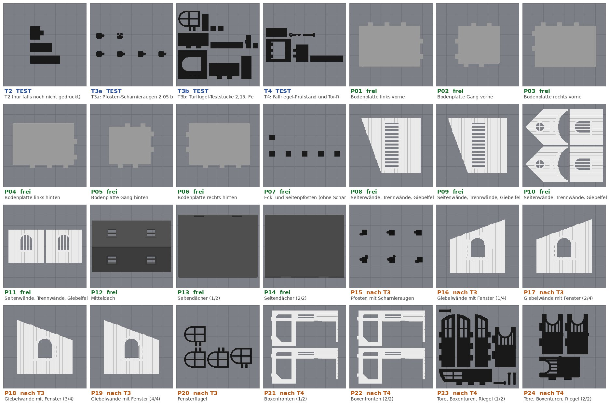

# Druckplan (Bambu Lab A1 mit AMS lite)

Erzeugt von `tools/report.py`. Zeiten und Filamentmengen sind **Schätzungen** aus PrusaSlicer 2.7
mit A1-ähnlichen Einstellungen (gleiche Schichthöhe, Wände, Füllung, Brim, Stützen).
Bambu Studio zeigt nach dem Slicen eigene Werte, die abweichen können.

AMS lite: **Slot 1 Weiß, Slot 2 Schwarz, Slot 3 Hellgrau, Slot 4 Dunkelgrau.**
Jede Datei ist ein fertiges Bambu-Studio-Projekt. Öffnen, slicen, drucken; Anleitung:
[BAMBU_STUDIO.md](BAMBU_STUDIO.md).

Die Spalte *passt mit Brim/Stützen* ist das Ergebnis des Probe-Slicens: Alle Bahnen
einschließlich Brim und Stützen liegen innerhalb des 256-mm-Betts.

## 1. Testplatten (zuerst)

| Datei (`1_TEST/`) | Inhalt | Preset | Slot | Besonderheit | Zeit | Filament | passt mit Brim/Stützen |
|---|---|---|---|---|---|---|---|
| `TEST_T2_Boden_Passungen.3mf` | T2 (nur falls noch nicht gedruckt): Bodensockel und Bodenverzahnung | Stall 0.24mm Boden @BBL A1 | 2 Schwarz |  | 0 h 33 min | 24 g | ja |
| `TEST_T3a_Pfosten_Scharnier.3mf` | T3a: Pfosten-Scharnieraugen 2,05 bis 2,45 und Nutenpfosten | Stall 0.20mm Pfosten Stuetzen v2 @BBL A1 | 2 Schwarz | Brim 8 mm, sanfte Beschleunigung (gespeichert); Baumstützen unter den Scharnieraugen | 4 h 57 min | 109 g | ja |
| `TEST_T3b_Tuer_Fenster.3mf` | T3b: Türflügel-Teststücke 2,15, Fenster-Teststück, Fensterstift, Wand- und Dachzapfen | Stall 0.20mm Standard @BBL A1 | 2 Schwarz | Brim 3 mm am Fensterflügel | 2 h 08 min | 70 g | ja |
| `TEST_T4_Verschluss.3mf` | T4: Fallriegel-Prüfstand und Tor-Riegel | Stall 0.20mm Standard @BBL A1 | 2 Schwarz |  | 1 h 05 min | 36 g | ja |

Testanleitung: [TESTANLEITUNG.md](TESTANLEITUNG.md). T2 nur, falls du T2 noch nicht gedruckt hast.

## 2. Produktionsplatten

Freigegebene Platten liegen in `2_PRODUKTION/`. Ihre Teile hängen nicht an den neuen Scharnier-
und Verschlusstests. Ihre Passungen (Bodensockel, Verzahnung, Wandnuten, Dachzapfen) sind aber
nur berechnet; T2, T3a und T3b prüfen sie mit. Die gesperrten Platten hängen an T3 oder T4. Ihre
Projektdateien erzeuge ich, sobald du mir die Testergebnisse meldest.

| Platte | Datei | Teile | Status | Preset | Slot | Besonderheit | Zeit | Filament | passt mit Brim/Stützen |
|---|---|---|---|---|---|---|---|---|---|
| P01 | `PROD_P01_Boden_LF.3mf` | floor_LF | **freigegeben** | Stall 0.24mm Boden @BBL A1 | 3 Hellgrau |  | 2 h 55 min | 131 g | ja |
| P02 | `PROD_P02_Boden_AF.3mf` | floor_AF | **freigegeben** | Stall 0.24mm Boden @BBL A1 | 3 Hellgrau |  | 1 h 57 min | 67 g | ja |
| P03 | `PROD_P03_Boden_RF.3mf` | floor_RF | **freigegeben** | Stall 0.24mm Boden @BBL A1 | 3 Hellgrau |  | 2 h 55 min | 131 g | ja |
| P04 | `PROD_P04_Boden_LB.3mf` | floor_LB | **freigegeben** | Stall 0.24mm Boden @BBL A1 | 3 Hellgrau |  | 2 h 55 min | 131 g | ja |
| P05 | `PROD_P05_Boden_AB.3mf` | floor_AB | **freigegeben** | Stall 0.24mm Boden @BBL A1 | 3 Hellgrau |  | 1 h 57 min | 67 g | ja |
| P06 | `PROD_P06_Boden_RB.3mf` | floor_RB | **freigegeben** | Stall 0.24mm Boden @BBL A1 | 3 Hellgrau |  | 2 h 56 min | 131 g | ja |
| P07 | `PROD_P07_Pfosten_kurz.3mf` | 4 x post_corner, 2 x post_sidemid | **freigegeben** | Stall 0.20mm Pfosten Stuetzen v2 @BBL A1 | 2 Schwarz | Brim 8 mm, sanfte Beschleunigung (gespeichert) | 7 h 33 min | 153 g | ja |
| P08 | `PROD_P08_Waende_1.3mf` | partition | **freigegeben** | Stall 0.20mm Standard @BBL A1 | 1 Weiß + 2 | Filamentwechsel auf Schwarz ab 3,0 mm (gespeichert) | 2 h 11 min | 67 g | ja |
| P09 | `PROD_P09_Waende_2.3mf` | partition | **freigegeben** | Stall 0.20mm Standard @BBL A1 | 1 Weiß + 2 | Filamentwechsel auf Schwarz ab 3,0 mm (gespeichert) | 2 h 11 min | 67 g | ja |
| P10 | `PROD_P10_Waende_3.3mf` | 2 x pediment, 2 x side_wall | **freigegeben** | Stall 0.20mm Standard @BBL A1 | 1 Weiß + 2 | Filamentwechsel auf Schwarz ab 3,0 mm (gespeichert) | 3 h 34 min | 110 g | ja |
| P11 | `PROD_P11_Waende_4.3mf` | 2 x side_wall | **freigegeben** | Stall 0.20mm Standard @BBL A1 | 1 Weiß + 2 | Filamentwechsel auf Schwarz ab 3,0 mm (gespeichert) | 1 h 51 min | 58 g | ja |
| P12 | `PROD_P12_Mitteldach.3mf` | roof_central | **freigegeben** | Stall 0.20mm Mitteldach @BBL A1 | 4 Dunkelgrau | Brim 5 mm | 7 h 16 min | 202 g | ja |
| P13 | `PROD_P13_Seitendaecher_1.3mf` | roof_side_A | **freigegeben** | Stall 0.20mm Standard @BBL A1 | 4 Dunkelgrau |  | 6 h 08 min | 146 g | ja |
| P14 | `PROD_P14_Seitendaecher_2.3mf` | roof_side_B | **freigegeben** | Stall 0.20mm Standard @BBL A1 | 4 Dunkelgrau |  | 6 h 08 min | 146 g | ja |
| P15 | `(folgt nach dem Test)` | 2 x post_jamb_L, 2 x post_jamb_R, 2 x post_mid | gesperrt bis T3 | Stall 0.20mm Pfosten Stuetzen v2 @BBL A1 | 2 Schwarz | Brim 8 mm, sanfte Beschleunigung (gespeichert); Baumstützen unter den Scharnieraugen | 17 h 39 min | 326 g | ja |
| P16 | `(folgt nach dem Test)` | gable_wing_A | gesperrt bis T3 | Stall 0.20mm Standard @BBL A1 | 1 Weiß + 2 | Filamentwechsel auf Schwarz ab 3,0 mm (gespeichert) | 2 h 00 min | 60 g | ja |
| P17 | `(folgt nach dem Test)` | gable_wing_A | gesperrt bis T3 | Stall 0.20mm Standard @BBL A1 | 1 Weiß + 2 | Filamentwechsel auf Schwarz ab 3,0 mm (gespeichert) | 2 h 00 min | 60 g | ja |
| P18 | `(folgt nach dem Test)` | gable_wing_B | gesperrt bis T3 | Stall 0.20mm Standard @BBL A1 | 1 Weiß + 2 | Filamentwechsel auf Schwarz ab 3,0 mm (gespeichert) | 2 h 00 min | 60 g | ja |
| P19 | `(folgt nach dem Test)` | gable_wing_B | gesperrt bis T3 | Stall 0.20mm Standard @BBL A1 | 1 Weiß + 2 | Filamentwechsel auf Schwarz ab 3,0 mm (gespeichert) | 2 h 00 min | 60 g | ja |
| P20 | `(folgt nach dem Test)` | 2 x casement_B, 2 x casement_A | gesperrt bis T3 | Stall 0.20mm Standard @BBL A1 | 2 Schwarz | Brim 3 mm am Fensterflügel | 0 h 36 min | 17 g | ja |
| P21 | `(folgt nach dem Test)` | 2 x stall_front | gesperrt bis T4 | Stall 0.20mm Standard @BBL A1 | 1 Weiß + 2 | Filamentwechsel auf Schwarz ab 3,0 mm (gespeichert) | 1 h 49 min | 58 g | ja |
| P22 | `(folgt nach dem Test)` | 2 x stall_front | gesperrt bis T4 | Stall 0.20mm Standard @BBL A1 | 1 Weiß + 2 | Filamentwechsel auf Schwarz ab 3,0 mm (gespeichert) | 1 h 49 min | 58 g | ja |
| P23 | `(folgt nach dem Test)` | 2 x main_leaf_A, 2 x main_leaf_B, stall_door, 4 x bolt_bar | gesperrt bis T4 | Stall 0.20mm Standard @BBL A1 | 2 Schwarz |  | 3 h 57 min | 117 g | ja |
| P24 | `(folgt nach dem Test)` | 3 x stall_door | gesperrt bis T4 | Stall 0.20mm Standard @BBL A1 | 2 Schwarz |  | 2 h 05 min | 66 g | ja |

| Summe | Platten | Zeit | Filament |
|---|---|---|---|
| freigegeben | 14 | 52 h 34 min | 1,61 kg |
| gesperrt (nach T3/T4) | 10 | 36 h 01 min | 0,88 kg |
| **ganzer Stall** | **24** | **88 h 36 min** | **2,49 kg** |

Filamentkosten bei 19,99 €/kg: etwa **50 €** für den ganzen Stall (ohne Tests und Fehldrucke).

## 3. Druckreihenfolge

1. **Tests:** T3a, T3b, T4 (und T2, falls noch nicht gedruckt). Ergebnisse an mich.
2. **Freigegebene Platten:** die Bodenplatten P01–P06, die Eck- und Seitenpfosten P07, die Wände
   P08–P11 und das Dach P12–P14. Druck sie, sobald die Passungstests gut ausgefallen sind: Sockel und
   Verzahnung (T2), Wandnut (T3a + T3b), Dachzapfen (T3b) mit den im Modell eingestellten Werten
   20 / 25 / 20 / 25. Passt ein anderer Wert besser, erzeuge ich diese Platten neu.
3. **Nach T3:** Pfosten mit Scharnieraugen P15, Giebelwände P16–P19, Fensterflügel P20.
4. **Nach T4:** Boxenfronten P21–P22, Türen P23–P24.

Die hohen Pfosten (P15) sind der heikelste Druck: Platte mit Spülmittel waschen und die erste Stunde
zuschauen. Die sanfteren Beschleunigungen sind in den Einstellungen gespeichert, am Drucker musst du
nichts umstellen.

