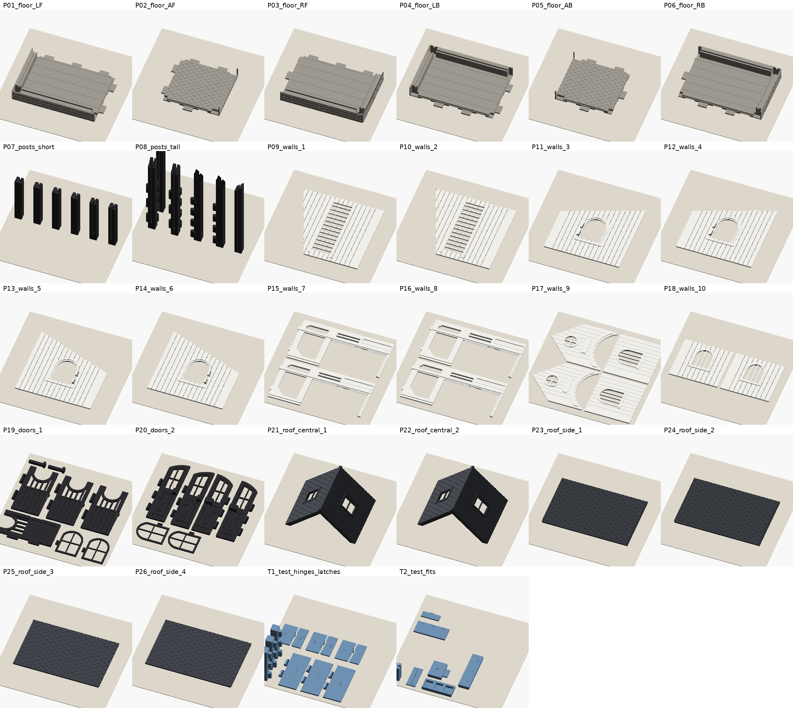

# Print plan (Bambu Lab A1)

Generated by `tools/report.py`. Times and weights are **estimates** from PrusaSlicer 2.7.2
with A1-equivalent speeds and accelerations (`tools/a1_pla_estimate.ini`). Nothing was
printed. Bambu Studio's own estimate will differ, possibly by +-20 %.

## Recommended settings

| Setting | Value | Why |
|---|---|---|
| Material | PLA or PLA+ (PETG optional for doors) | stiff, easy, low warp; PETG flexes more forgivingly in the latch tongues |
| Nozzle | 0.4 mm | details (board grooves 1.1 mm, latch 1.8 mm tongue) are sized for it |
| Layer height | 0.20 mm (Bambu "0.20mm Standard @BBL A1") | 0.16 mm for the doors is optional |
| Wall loops | 3 | stronger panels, grooves and sockets |
| Top / bottom shells | 5 / 4 | flat textured surfaces close well |
| Sparse infill | 15 % grid (gyroid also fine) | floor tiles and plinth are modelled solid |
| Supports | **off** for every part | everything is designed support-free |
| Brim | 5 mm for the posts (upright) and the central roof units | tall, narrow footprints |
| Plate | Textured PEI, 65 C (Bambu PLA default) | textured underside looks good on panels |
| Seam | Aligned or back | |
| Part cooling | Bambu PLA default | 45 deg overhangs on the central roof need good cooling |

### Black trim on white panels (optional)

White panels carry raised trims (window frames, rails, the door arch, bars) from **Z = 2.8 mm**.
In Bambu Studio's preview, right-click the layer slider at 2.8 mm, the last white layer, and choose
**Add color change** (AMS / AMS lite) or **Add pause** (no AMS: swap to black when it
pauses). Plates marked "trim" below benefit from this. The trim can also be left white or
painted.

## Plates

Print the test plates **T1/T2 first** (see `TESTING.md`) and adjust `config.scad` if needed.

| Plate (3MF) | Parts | Colour | Est. time | Est. filament |
|---|---|---|---|---|
| `P01_floor_LF.3mf` | floor_LF | grey | 3 h 04 min | 125 g |
| `P02_floor_AF.3mf` | floor_AF | grey | 1 h 58 min | 63 g |
| `P03_floor_RF.3mf` | floor_RF | grey | 3 h 03 min | 124 g |
| `P04_floor_LB.3mf` | floor_LB | grey | 3 h 04 min | 124 g |
| `P05_floor_AB.3mf` | floor_AB | grey | 1 h 57 min | 62 g |
| `P06_floor_RB.3mf` | floor_RB | grey | 3 h 05 min | 124 g |
| `P07_posts_short.3mf` | post_corner, post_corner, post_corner, post_corner, post_sidemid, post_sidemid (upright) | black | 5 h 13 min | 117 g |
| `P08_posts_tall.3mf` | post_jamb_L, post_jamb_L, post_jamb_R, post_jamb_R, post_mid, post_mid (upright) | black | 10 h 29 min | 229 g |
| `P09_walls_1.3mf` | partition | white + black trim (optional) | 2 h 05 min | 63 g |
| `P10_walls_2.3mf` | partition | white + black trim (optional) | 2 h 05 min | 63 g |
| `P11_walls_3.3mf` | gable_wing_A | white + black trim (optional) | 1 h 59 min | 59 g |
| `P12_walls_4.3mf` | gable_wing_A | white + black trim (optional) | 1 h 59 min | 59 g |
| `P13_walls_5.3mf` | gable_wing_B | white + black trim (optional) | 1 h 59 min | 59 g |
| `P14_walls_6.3mf` | gable_wing_B | white + black trim (optional) | 1 h 59 min | 59 g |
| `P15_walls_7.3mf` | stall_front, stall_front | white + black trim (optional) | 1 h 49 min | 58 g |
| `P16_walls_8.3mf` | stall_front, stall_front | white + black trim (optional) | 1 h 49 min | 58 g |
| `P17_walls_9.3mf` | pediment, pediment, side_wall, side_wall | white + black trim (optional) | 3 h 34 min | 110 g |
| `P18_walls_10.3mf` | side_wall, side_wall | white + black trim (optional) | 1 h 51 min | 58 g |
| `P19_doors_1.3mf` | stall_door, stall_door, stall_door, stall_door, casement_A, casement_A, bolt_bar, bolt_bar | black | 3 h 04 min | 96 g |
| `P20_doors_2.3mf` | casement_B, casement_B, main_leaf_A, main_leaf_A, main_leaf_B, main_leaf_B | black | 3 h 10 min | 95 g |
| `P21_roof_central_1.3mf` | roof_central | dark grey | 3 h 57 min | 111 g |
| `P22_roof_central_2.3mf` | roof_central | dark grey | 3 h 57 min | 111 g |
| `P23_roof_side_1.3mf` | roof_side_A | dark grey | 3 h 10 min | 76 g |
| `P24_roof_side_2.3mf` | roof_side_A | dark grey | 3 h 10 min | 76 g |
| `P25_roof_side_3.3mf` | roof_side_B | dark grey | 3 h 10 min | 76 g |
| `P26_roof_side_4.3mf` | roof_side_B | dark grey | 3 h 10 min | 76 g |
| `T1_test_hinges_latches.3mf` | plate_T1 | any | 2 h 58 min | 97 g |
| `T2_test_fits.3mf` | plate_T2 | any | 1 h 27 min | 43 g |

## Totals for the stable (26 plates, test plates excluded)

| Colour | Time | Filament |
|---|---|---|
| grey | 16 h 14 min | 0.62 kg |
| black | 21 h 58 min | 0.54 kg |
| white | 21 h 14 min | 0.65 kg |
| dark grey | 20 h 38 min | 0.53 kg |
| **all** | **80 h 05 min** | **2.33 kg** |

Filament to have on hand (estimate + 10 % for purge, brims and failed prints): grey 0.68 kg, black 0.59 kg, white 0.71 kg, dark grey 0.58 kg.
The roof can also use the black spool (black then 1.17 kg).

## Recommended order

1. **T1, T2** test coupons, then evaluate them (TESTING.md).
2. **P07-P08** posts. The tall posts take longest; let them run overnight.
3. **P01-P06** floor tiles. Assemble the base as soon as two tiles are done.
4. **P09-P18** walls, partitions, stall fronts, pediments (white, optional trim change).
5. **P19-P20** doors and windows (black). PETG optional.
6. **P21-P26** roof.

## Orientation notes

* All 3MF plates are already oriented and arranged; the individual STLs in `stl/` are in print orientation too.
* Posts stand upright (grooves and hinge bores print round and strong).
* The central roof units print standing on their eave edges, as installed. Use a 5 mm brim and keep the plate clean.
* Everything else prints flat. The exterior or show face is up.
* If the first layer of the large panels lifts at the corners: clean the plate (soap and water), raise the bed temperature by 5 C, add a 3 mm brim.

