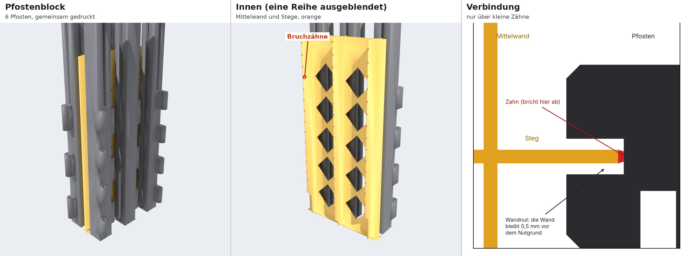

# Pferdestall: STL-Dateien

Stand 10. November 2026. Alle Teile als STL, die Druckeinstellungen wählst du selbst.
Eingearbeitet sind deine Testergebnisse aus T1 bis T4 und der Fallriegel. Was sich geändert hat, steht in
[AENDERUNGEN.md](AENDERUNGEN.md). Die vollständige Liste mit Stückzahl, Farbe, Stützen und Brim
steht in [TEILELISTE.md](TEILELISTE.md).

## Ordner

| Ordner | Inhalt |
|---|---|
| `Aufbauanleitung.pdf` | Zusammenbau Schritt für Schritt, mit Bildern |
| `2_PRODUKTION/1_Boden_hellgrau/` | 6 Bodenplatten |
| `2_PRODUKTION/2_Pfosten_schwarz/` | `Einzeln/` (12 Pfosten) **oder** `Pfostenblock/` (dieselben 12 Pfosten in zwei Blöcken) |
| `2_PRODUKTION/3_Waende_weiss_mit_schwarzen_Leisten/` | je Wand zwei Dateien: `..._Wand_weiss` und `..._Leisten_schwarz` |
| `2_PRODUKTION/4_Tueren_Fenster_schwarz/` | Tore, Torriegel, Boxentüren, Fallriegel-Hebel, Fensterflügel |
| `2_PRODUKTION/5_Dach_dunkelgrau/` | Mitteldach, 2 Seitendächer |
| `Anleitungen/` | Teileliste, Testanleitung, Änderungen, Verschluss, Verbindungen |

Die Zahl im Dateinamen ist die Stückzahl, zum Beispiel `Boxentuer_4x.stl`: 4-mal drucken. Alle
Dateien liegen schon richtig herum: flache Teile mit der Schauseite nach oben, Pfosten stehend.
Bitte nicht drehen oder kippen. Auf dem Bett verschieben und um die senkrechte Achse drehen ist
in Ordnung.

## Reihenfolge und Aufbau

Alle Tests sind erledigt, du kannst alles drucken, in beliebiger Reihenfolge. Wie du den Stall
zusammenbaust, zeigt die **`Aufbauanleitung.pdf`** Schritt für Schritt mit Bildern.

## Wände in Weiß mit schwarzen Leisten

Jede Wand besteht aus zwei Dateien mit denselben Koordinaten: der weißen Wand und den schwarzen
Leisten darauf. So geht es in Bambu Studio:

1. Links bei den Filamenten zwei Filamente anlegen: Weiß und Schwarz.
2. **Beide Dateien gleichzeitig** importieren (Strg+I, beide markieren).
3. Bambu Studio fragt, ob die Dateien **ein Objekt mit mehreren Teilen** sein sollen: **Ja**.
4. In der Objektliste dem Teil `..._Wand_weiss` Weiß zuweisen und `..._Leisten_schwarz` Schwarz.
5. Kontrolle in der Vorschau: Die Leisten liegen **auf** der Wand, nicht daneben auf dem Bett.

Falls die Frage nicht kommt und die Leisten als eigenes Objekt auf dem Bett liegen: Rückgängig
machen und die Ersatzdatei aus dem Unterordner `einteilig_mit_Farbwechsel/` nehmen (Wand und
Leisten in einer Datei). Dort in der Vorschau am Schichtregler bei der **ersten Schicht über
2,8 mm** einen Filamentwechsel auf Schwarz einfügen. Alles darüber sind Leisten.

## Pfosten: einzeln oder als Block

Die hohen Pfosten (bis 216 mm, nur 16 mm dick) können sich auf dem A1 lösen, weil sich das Bett
vor und zurück bewegt. Dagegen gibt es jetzt den **Pfostenblock**: 6 Pfosten werden zusammen
gedruckt und halten sich gegenseitig.

* In der Mitte steht eine dünne Wand mit Rautenlöchern. Von ihr geht zu jedem Pfosten ein dünner
  Steg in eine seiner Wandnuten.
* Der Steg berührt den Nutgrund nur alle 10 mm an einem kleinen Zahn (0,8 × 0,6 mm). Die
  Seitenflächen der Nut, an denen später die Wand gleitet, berührt er nicht.
* **Abtrennen:** Block vom Bett nehmen, dann jeden Pfosten am oberen Ende greifen und vorsichtig
  von der Mittelwand weg biegen. Die Zähne brechen nacheinander. Reste am Nutgrund stören nicht,
  denn die Wand reicht dort nicht hin (0,5 mm Luft). Nicht feilen.
* Den Block so auf das Bett legen, wie er kommt: die Mittelwand läuft **von vorne nach hinten**
  (in Bewegungsrichtung des Betts). So ist er am steifsten.
* Mehrverbrauch laut Schätzung: Block mit den Scharnierpfosten etwa 1¼ Stunden und 35 g, Block
  mit den äußeren Pfosten etwas weniger.

Druckst du lieber einzeln: Die Einzelpfosten sind dieselben Teile ohne Mittelwand und Stege.
Dann mit Brim (8 mm) und nicht zu hoher Beschleunigung drucken.

**Stützen bei den Pfosten:** nur unter den Scharnieraugen (Torpfosten, Mittelpfosten). Baumstützen,
„Nur auf dem Druckbett“ **aus**, denn die Stützen stehen auf dem Auge darunter. Kontrolliere in
der Vorschau, dass keine Stütze in einem Loch steckt.

## Einstellungen: meine Werte zum Vergleich

Du stellst selbst ein. Damit du weißt, womit deine Tests gedruckt wurden: Die Passungen
(Pfostenloch 2,05, Pfostennut 0,15, Fensterklemmung 1,95, Türloch 2,15) sind mit diesen Werten
bestätigt. Mit 0,20 mm Schichthöhe wird alles eher genauer. Andere Filamentsorten, ein anderer
Durchfluss oder eine Lochkompensation können eine Passung enger oder lockerer machen.

| Teile | Schichthöhe beim Test | Wände | Stützen | Brim |
|---|---|---|---|---|
| Pfosten | 0,24 mm | 2 | nur unter den Scharnieraugen | 8 mm einzeln, 5 mm am Block |
| Türen, Fensterflügel, Hebel, Giebelwände, Boxenfronten | 0,20 mm | 2 | keine | Fensterflügel 3 mm |
| Seitenwände, Trennwände, Giebelfelder | 0,24 mm | 2 | keine | – |
| Boden, Dach | 0,28 mm; Sockel, Verzahnung und Dachzapfen mit deinen Einstellungen bestätigt (T2) | 2 | keine | Mitteldach 5 mm |

## Stifte

Alle Scharnierstifte sind Stücke von 1,75-mm-Filament: 4 × etwa 126 mm (Tore), 4 × etwa
122 mm (Boxentüren), 4 × etwa 30 mm (Fenster). Gerade ziehen, quer abschneiden, Enden mit dem
Fingernagel entgraten.
