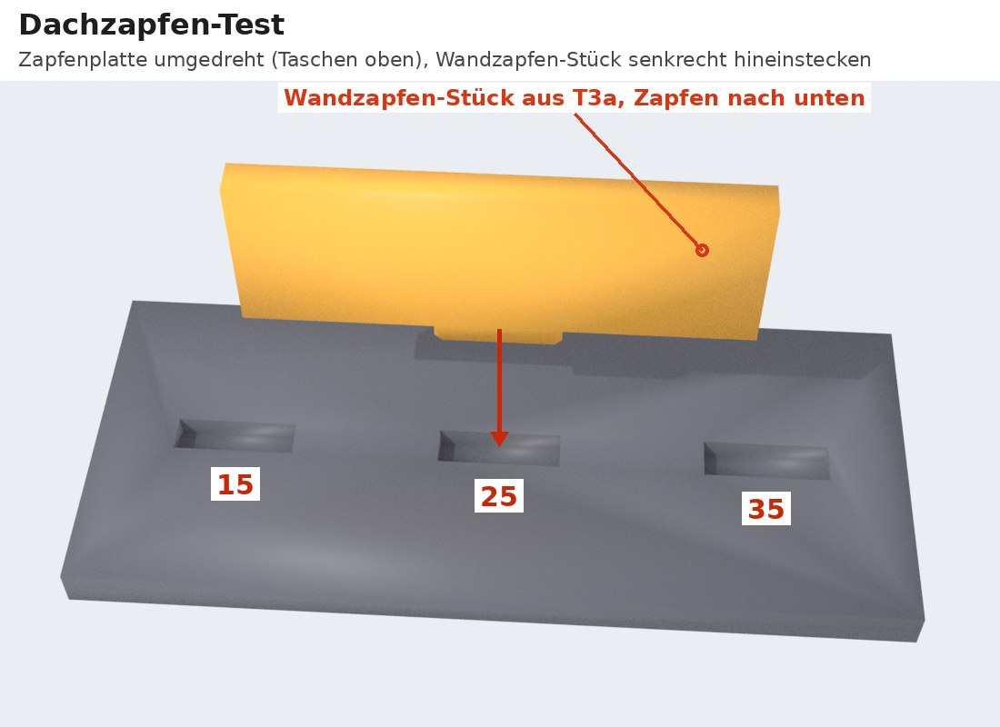
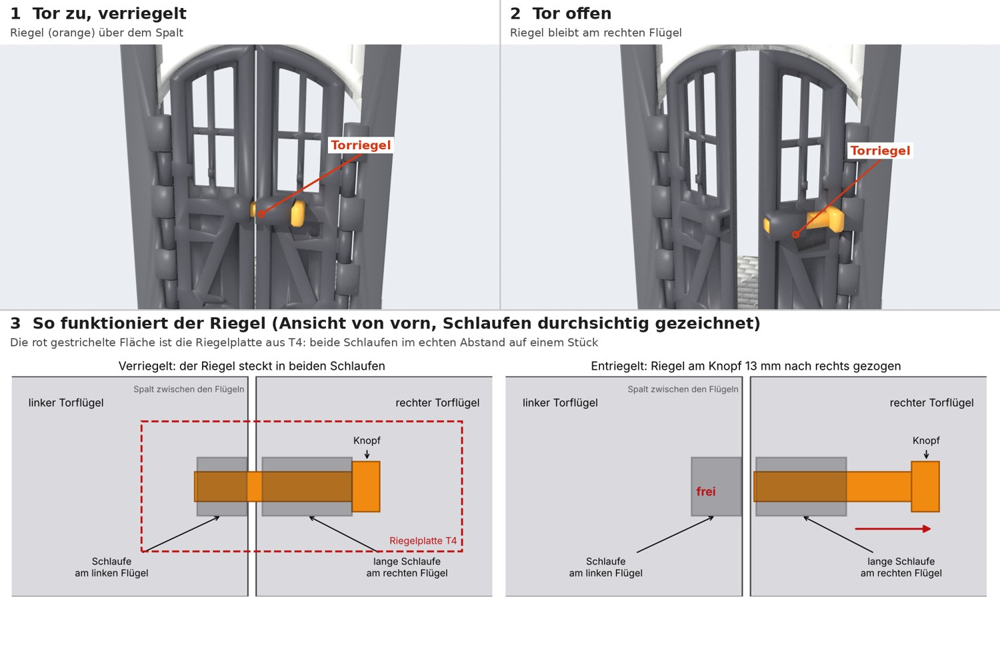
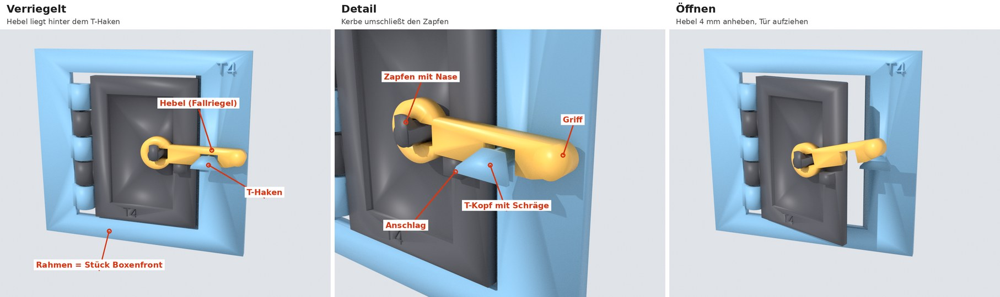

# Testanleitung: was noch offen ist

Stand 10. November 2026. Fast alles ist getestet. Offen sind nur noch der **Dachzapfen-Test**
(die Teile hast du schon) und ein kurzer Handgriff mit dem **Torriegel**.

**Wichtig für alle Tests:** nicht aufbohren, nicht feilen, nicht nachschneiden. Bewerte jedes
Teil so, wie es vom Drucker kommt.

## Deine Ergebnisse (eingearbeitet)

| Test | Ergebnis | Übernommen |
|---|---|---|
| T1 Türflügel | 2,15 am besten | Loch in Türen und Fensterflügeln 2,15 mm |
| T3a Pfostenstücke | **2,05** am besten | Loch in allen Pfosten-Scharnieraugen 2,05 mm |
| T3a Nutenpfosten | **15** am besten | Wandnuten in allen Pfosten 0,15 mm Luft je Seite |
| T3b Fuß | Wandstück passt | Nut in Sockel und Boden 0,20 mm, wie im Fuß |
| T3b Fensterstift | **1,95** am besten | oberes Fensterauge an der Giebelwand 1,95 mm |
| T2 Sockelplatte | **15** am besten | Pfostensockel in den Bodenplatten 0,15 mm Luft je Seite (vorher 0,20) |
| T2 Bodenverzahnung | **15** am besten | Bodenverzahnung 0,15 mm Luft je Seite (vorher 0,25) |
| T4 Fallriegel | funktioniert | bleibt so, wie er in Boxentüren und Boxenfronten eingebaut ist |

## Offen 1: Dachzapfen-Test

**Was wird getestet?** Oben an den Giebelwänden, Trennwänden und Boxenfronten sitzen kleine
Zapfen. Sie stecken in Taschen an der **Unterseite** der Dächer. So kann das Dach nicht
verrutschen. Die Zapfenplatte ist ein Stück Dach mit drei solchen Taschen, das
Wandzapfen-Stück ist ein Stück Wandoberkante mit einem Zapfen.

**Teile:** Zapfenplatte (aus T2) und Wandzapfen-Stück (aus T3a: das flache Stück, 40 × 14 mm,
mit dem kleinen Zapfen an einer langen Kante).

1. **Zapfenplatte umdrehen.** Die Taschen liegen auf der Unterseite, also auf der Seite, die
   auf dem Druckbett lag. Die Zahlen stehen oben. Dreh die Platte über die lange Kante um, dann
   bleibt die Reihenfolge gleich: links 15, Mitte 25, rechts 35. Jede Zahl steht genau über
   ihrer Tasche.
2. **Wandzapfen-Stück senkrecht halten**, wie eine kleine Wand, den Zapfen nach unten.
3. Den Zapfen nacheinander in jede der drei Taschen stecken, ohne Druck.

| Ergebnis | Bedeutung |
|---|---|
| A: geht nicht oder nur mit Druck hinein | zu eng |
| B: fällt von selbst oder mit ganz leichtem Druck hinein und hat kaum Spiel | **ideal** |
| C: fällt hinein und wackelt deutlich hin und her | zu locker |

Gesucht ist die **kleinste Tasche mit B**. Im Modell sind 25 eingestellt.

**Melde mir:** für 15, 25 und 35 jeweils A, B oder C.

## Offen 2: Torriegel kurz ausprobieren

**Wozu ist das?** Das große Tor in der Mitte hat zwei Flügel. Außen auf beiden Flügeln sitzt in
Riegelhöhe je eine Schlaufe: eine kurze am linken Flügel, eine lange am rechten. Der
**Torriegel** ist ein Stab mit einem Knopf am Ende, der durch beide Schlaufen geschoben wird.

* **Verriegelt:** Der Riegel steckt in beiden Schlaufen und überbrückt den Spalt zwischen den
  Flügeln. Keiner der beiden Flügel geht auf.
* **Entriegelt:** Am Knopf 13 mm nach rechts ziehen. Der Riegel kommt aus der linken Schlaufe
  heraus, bleibt aber in der langen rechten Schlaufe stecken. Jetzt gehen beide Flügel auf.
  Der Riegel fährt am rechten Flügel mit und geht nicht verloren.

Die **Riegelplatte** aus T4 ist genau der rot gestrichelte Ausschnitt: beide Schlaufen im
echten Abstand, aber auf einem Stück statt auf zwei Flügeln. Damit prüfst du nur, ob der
Riegel gut durch die Schlaufen gleitet.

**So probierst du es:** Den Torriegel mit dem glatten Ende voran von rechts in die lange
Schlaufe schieben, weiter durch die kurze Schlaufe, bis der Knopf an der langen Schlaufe
anliegt. Dann wieder 13 mm zurückziehen und wieder hineinschieben.

Gut ist, wenn er von Hand ohne Kraft gleitet, nicht klemmt und nicht spürbar wackelt (Luft
0,3 mm je Seite).

**Melde mir:** gleitet / klemmt / wackelt.

---

## T4: Fallriegel (erledigt, zum Nachlesen)

**Was wird getestet?** Der neue Verschluss für die Boxentüren (Erklärung und Vergleich:
[VERSCHLUSS.md](VERSCHLUSS.md)) und der Schieberiegel der großen Tore.

**Teile, die zusammengehören:**

| Teile | Gehören zu |
|---|---|
| Rahmen + Testtür + Hebel + 45-mm-Stift, dazu der Fuß aus T3b (liegt auch als STL bei) | Fallriegel-Prüfstand. Rahmen und Tür sind ein Stück Boxenfront und Boxentür in Originalmaßen |
| Riegelplatte + Torriegel | Tor-Riegel. Der Riegel ist ein echtes Produktionsteil |

**Aufbau des Prüfstands:**

1. Rahmen mit der Unterkante in den Fuß aus T3b stecken.
2. Die Testtür mit ihren Augen in die Lücken der Rahmenaugen halten und den 45-mm-Stift
   **von oben** durch alle Augen stecken.
3. **Hebel aufstecken:** Hebel senkrecht nach oben halten, sodass seine Kerbe über der Nase
   des Zapfens steht. Aufschieben, dann nach unten drehen, bis er auf dem kleinen Anschlag
   liegt.

**Test 1, Einrasten:** Tür ganz öffnen und mit einem Finger zudrücken. Der Hebel muss über die
Schräge des T-Hakens gleiten und dahinter hörbar einfallen. Mach das 10-mal, auch langsam.

**Test 2, Halt:** Tür geschlossen, an der freien Kante ziehen. Sie darf sich nur 1 bis 2 mm
bewegen und muss dann fest halten, auch bei einem kräftigen Ruck wie im Spiel. Dabei darf sich
nichts sichtbar verbiegen.

**Test 3, Öffnen:** Hebel am runden Griff etwa 4 mm anheben und die Tür aufziehen. Das soll mit
einer Hand und ohne Kraft gehen. Lässt du den Hebel bei offener Tür los, fällt er wieder auf
seinen Anschlag.

**Test 4, Dauertest:** 100-mal öffnen und schließen (mitzählen). Danach prüfen:

* Rastet es noch zuverlässig ein?
* Fällt der Hebel noch von selbst?
* Ist irgendwo Abrieb zu sehen (glänzende oder abgerundete Kanten an der Schräge)?

**Test 5, unverlierbar:** Versuch, den Hebel abzuziehen, einmal waagerecht und einmal halb
angehoben. Er darf nicht abgehen. Senkrecht nach oben gestellt geht er ab; so wird er montiert.

**Test 6, Kippen:** Prüfstand um etwa 30 Grad nach vorn und nach hinten neigen. Die Tür muss
verriegelt bleiben. Auf dem Kopf fällt der Hebel auf, das ist bei einem Fallriegel normal.

Dein Ergebnis: funktioniert. Falls du den Dauertest (Test 4) noch machst und danach etwas
auffällt, sag mir Bescheid.

---

## T2: Bodensockel und Bodenverzahnung (erledigt)

Dein Ergebnis: Sockel 15, Verzahnung 15. Beides ist eingebaut. Den Dachzapfen-Test aus T2
beschreibt „Offen 1“ oben.
