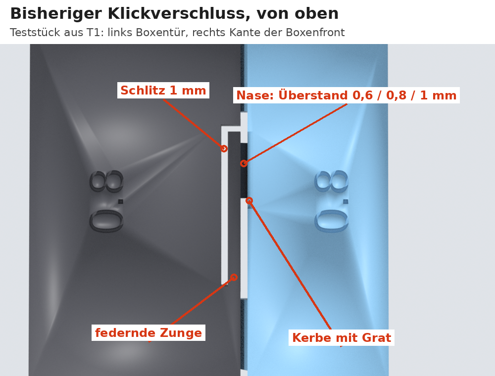
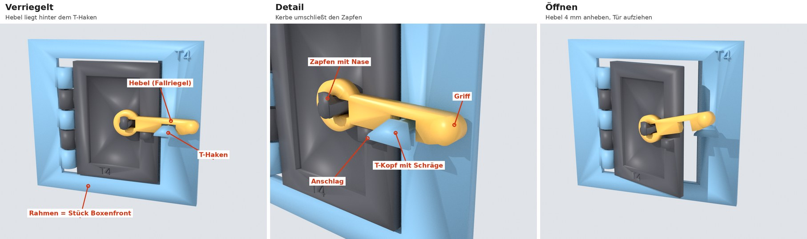
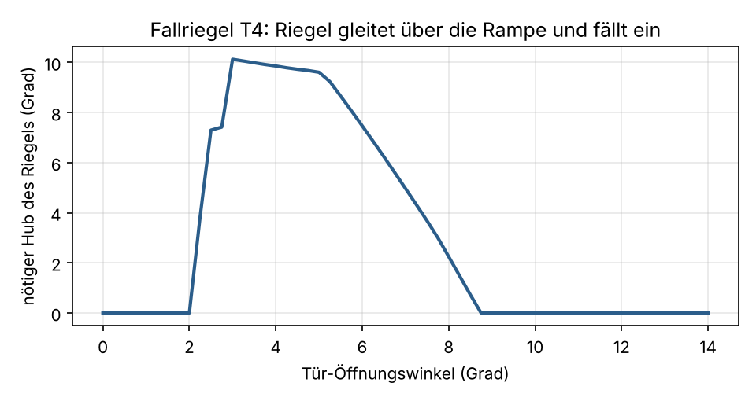
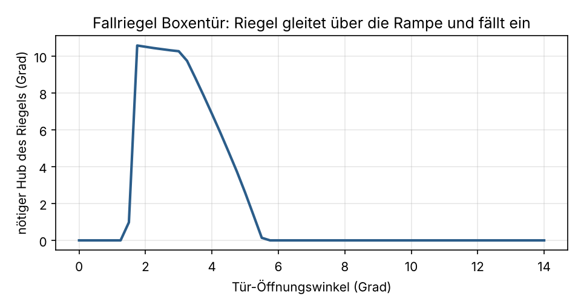

# Boxentür-Verschluss: Prüfung und Empfehlung

Stand 10. November 2026. Auf deinen Wunsch ist der **Fallriegel jetzt in die Boxentüren und
Boxenfronten eingebaut** (STL-Dateien). Dein Teststück **T4** funktioniert (deine Meldung vom
10. November). Die Zahlen unten sind berechnet bzw. am Rechner simuliert.

## 1. So funktioniert der bisherige Klickverschluss

* An der freien Kante der Boxentür ist eine **federnde Zunge** freigeschnitten: 22 mm lang,
  1,8 mm breit, daneben ein 1 mm breiter Schlitz. Am Ende der Zunge sitzt eine kleine,
  schräge **Nase** (8 mm hoch).
* Die Boxenfront hat an der Kante, an die die Tür schlägt, eine passende **Kerbe** mit einem
  kleinen **Grat** davor.
* Beim Schließen drückt der Grat die Nase zur Seite. Die Zunge biegt sich in der Türebene
  und schnappt hinter dem Grat in die Kerbe: **Klick**. Zum Öffnen zieht man an der Tür, die
  Schräge der Nase drückt die Zunge wieder zur Seite.
* **Die Zahlen 0,6 / 0,8 / 1 auf deinen Teststücken aus T1** sind der Überstand der Nase über
  die Türkante in Millimetern (im Modell `latch_engage`). So weit muss sich die Zunge beim
  Einrasten durchbiegen. Mehr Überstand bedeutet mehr Halt, aber auch mehr Kraft und mehr
  Biegung. Im Modell sind 0,8 mm eingestellt.

## 2. Kritische Prüfung des Klickverschlusses

* **Der Halt hängt an 0,8 mm, und genau in dieser Richtung addieren sich die Spiele.** Die
  Boxenfront steckt an beiden Enden mit je 0,5 mm Luft in den Pfostennuten und kann sich
  längs verschieben. Dazu kommen das Scharnierspiel (2,15-mm-Loch auf 1,75-mm-Stift), der
  Sitz der Pfosten im Boden und kleine Druckabweichungen. Zusammen sind das bis etwa
  **±1 mm**. Der wirksame Überstand schwankt damit zwischen fast 0 mm (Tür hält nicht) und
  rund 1,8 mm (mehr als der 1-mm-Schlitz erlaubt: Tür klemmt oder rastet nur mit Gewalt).
  Weil die Boxenfront nachgeben kann, weicht sie beim Schließen eher aus, statt die Zunge zu
  biegen.
* Deine Einzelteststücke aus T1 zeigen das nicht: Sie werden ohne Scharnier und ohne
  Boxenfront von Hand zusammengeschoben.
* **PLA:** Die Biegung selbst ist für PLA tragbar (etwa 0,5 % Dehnung). Aber Nase und Grat
  reiben bei jedem Öffnen PLA auf PLA. Sie runden sich ab, und der Halt lässt mit der Zeit nach.
* **Halt im Spiel:** Der Verschluss hält nur über eine 45-Grad-Schräge. Ein kräftiger Zug
  oder ein Stoß von innen öffnet ihn.
* **Reparatur:** Bricht die Zunge, muss die ganze Tür neu gedruckt werden.

**Ergebnis:** Der Klickverschluss überzeugt im Vergleich nicht. Ich empfehle ihn zu ersetzen.

## 3. Vergleich

| Kriterium | Klickverschluss (bisher) | Schieberiegel | Drehriegel (Vorreiber) | **Fallriegel (neu)** |
|---|---|---|---|---|
| Druck auf dem A1 mit PLA | gut, flach | gut (Führungen als Brücken) | gut | **gut, flach, ohne Stützen** (alle Schrägen 45 Grad) |
| Bedienung | Tür zudrücken / aufziehen | Tür zu, dann Riegel schieben | Tür zu, dann Knebel drehen | **Tür zudrücken, Riegel fällt von selbst ein**. Öffnen: Riegel 4 mm anheben, Tür aufziehen |
| Halt im Spiel | schwach, springt bei Zug auf | fest, kann aber von selbst zurückrutschen | fest, kann sich von selbst verdrehen | **formschlüssig**: Ziehen an der Tür drückt den Riegel nur fester gegen den Haken. Öffnet nur durch Anheben |
| Haltbarkeit, PLA, oft öffnen | Biegung bei jedem Öffnen, Nase und Grat nutzen sich ab | gut | gut | **gut**: nichts biegt sich. Beim Schließen gleitet der Riegel mit seinem Eigengewicht (unter 1 g) über eine Schräge |
| Empfindlich für Druck- und Montageabweichungen | **hoch** (0,8 mm Überstand gegen ±1 mm Spiel) | mittel (Gleitpassung) | gering | **gering**: in der Simulation funktioniert er bei ±1 mm seitlich und ±0,4 mm Höhe |
| Montage, Nacharbeit | keine | Riegel einfädeln | Stift oder Steckachse | **Riegel aufstecken und nach unten drehen**, kein Werkzeug, kein Kleber |
| Lose Teile, Verschleiß, Austausch | keine losen Teile; bricht die Zunge, muss die Tür neu gedruckt werden | loser Riegel, kann verloren gehen | kleines Teil, gesichert | **ein kleiner Hebel je Tür, im Spiel unverlierbar** (geht nur senkrecht nach oben gestellt ab), in Sekunden ersetzbar |

Ein Magnetverschluss scheidet aus. Man müsste Magnete kaufen und einkleben. Kleine starke
Magnete sind in Kinderspielzeug außerdem eine Verschluckgefahr.

## 4. Empfehlung: Fallriegel

* An der Tür sitzt ein **Hebel** (orange im Bild) auf einem kurzen Zapfen nahe der freien
  Kante. Die Schwerkraft hält ihn waagerecht auf einem kleinen Anschlag.
* An der Boxenfront sitzt ein **T-Haken**: ein kurzer Zapfen mit einem querliegenden Kopf.
* **Schließen:** Der Hebel läuft auf die Schräge des T-Kopfes, wird angehoben und fällt
  dahinter mit einem Klack wieder herunter. Die Kerbe im Hebel umschließt dann den Zapfen.
* **Gesperrt:** Zieht man an der Tür, stößt der Hebel gegen die Unterseite des T-Kopfes. Die
  Tür bewegt sich nur 1 bis 2 mm (Simulation: 0,9 bis 1,8 mm am Haken).
* **Öffnen:** Hebel am Griff um etwa 4 mm anheben (rund 10 bis 15 Grad) und Tür aufziehen.
* **Unverlierbar:** Der Zapfen hat eine einseitige Nase, der Hebel eine passende Kerbe. Beide
  stehen nur übereinander, wenn der Hebel senkrecht nach oben zeigt. So steckt man ihn auf
  und nimmt ihn ab. In jeder anderen Stellung hält ihn die Nase fest.

Was am Rechner geprüft ist (`tools/latch_sim.py`, Ergebnis in `build/latch_sim.json`):

| Prüfung | Ergebnis |
|---|---|
| Tür zu, Hebel unten: berührt sich etwas? | nein |
| Gesperrt: wie weit geht die Tür auf, bis der Hebel greift? | 0,9 bis 1,8 mm am Haken |
| Schließen: nötiger Hub des Hebels über den Türwinkel | steigt gleichmäßig an (Rampe, keine Kante), fällt am Ende auf 0 (Einrasten) |
| Größter Hub | 3,2 mm an der Kerbe (rund 10 Grad) |
| Toleranz: Boxenfront ±1 mm seitlich, Tür ±0,4 mm in der Höhe | in allen 9 Kombinationen: frei bei geschlossener Tür, sperrt, hebt gleichmäßig |
| Hebel abziehen: waagerecht / 45 Grad / senkrecht | hält / hält / geht ab |

**Noch nicht geprüft, das zeigt erst dein T4-Test:** wie leicht der Hebel wirklich gleitet und
einfällt, wie fest der Druck hält, ob sich nach vielen Wiederholungen etwas abnutzt.

**Eingebaut am 10. November** (ohne T4-Ergebnis, auf deinen Wunsch): Boxentür mit Zapfen,
Schlüsselnase und Anschlag, Boxenfront mit T-Haken, dazu der lose Hebel (4 Stück). Der alte
Klickverschluss ist entfernt. Der Hebeldrehpunkt sitzt 66 mm über dem Tisch auf den glatten
Brettern der Tür. Am Rechner mit der echten Boxentür und Boxenfront nachgeprüft:

* geschlossen berührt nichts; der Hebel sperrt die Tür nach 1,9 mm Spiel;
* beim Schließen hebt die Schräge den Hebel um bis zu 3,3 mm an, dann fällt er ein;
* der Hebel geht nur senkrecht nach oben gestellt ab;
* Boxenfront ±1 mm seitlich, Tür ±0,4 mm in der Höhe: sperrt in allen 9 Fällen;
* Türschwung und Pferdedurchgang unverändert (Tür frei bis 90 bzw. 105 Grad).

Fällt T4 schlecht aus, sag mir, was nicht passt. Dann ändere ich Hebel, Zapfen und Haken und
schicke dir neue STL-Dateien für Boxentüren, Boxenfronten und Hebel.
